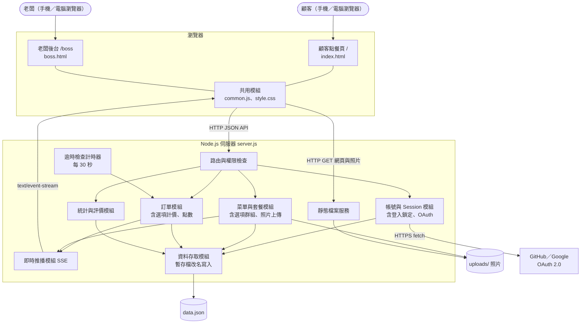
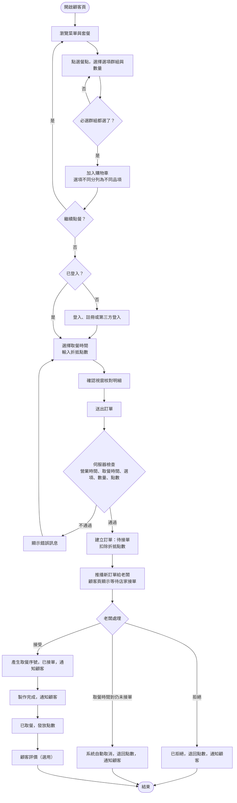
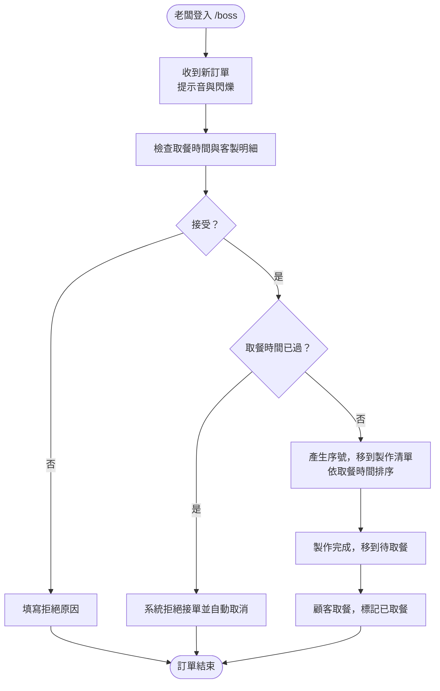
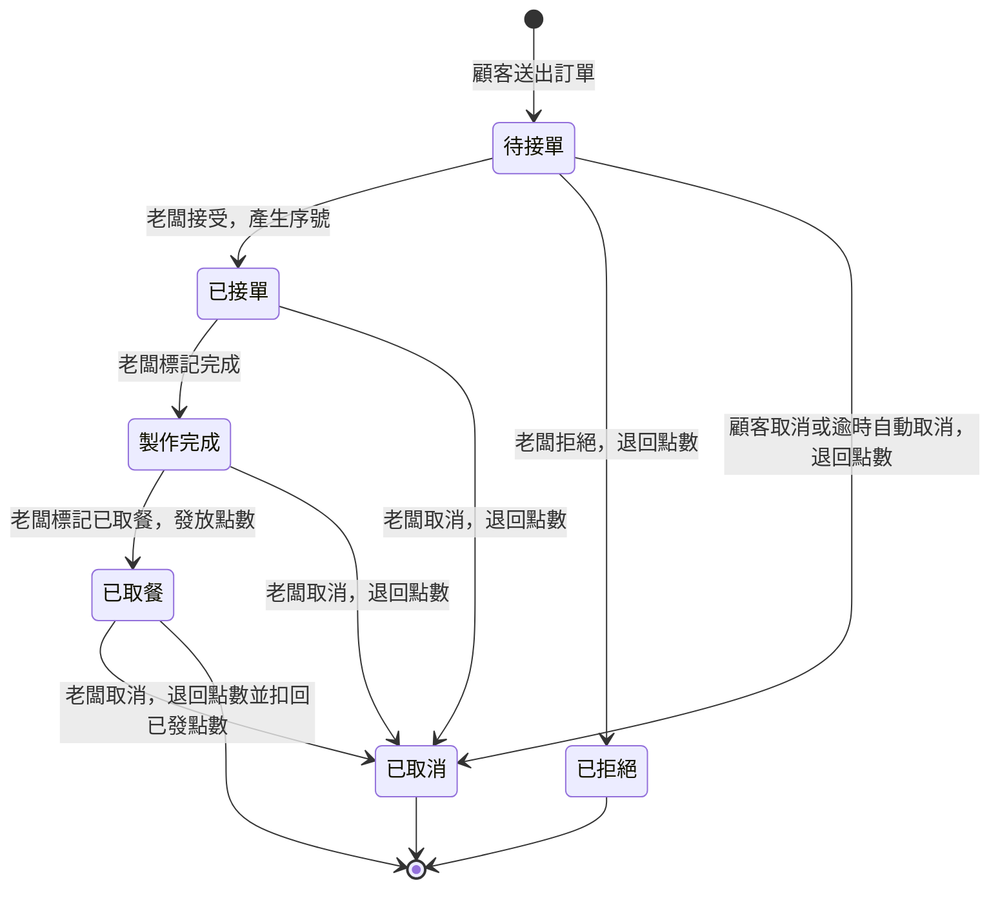
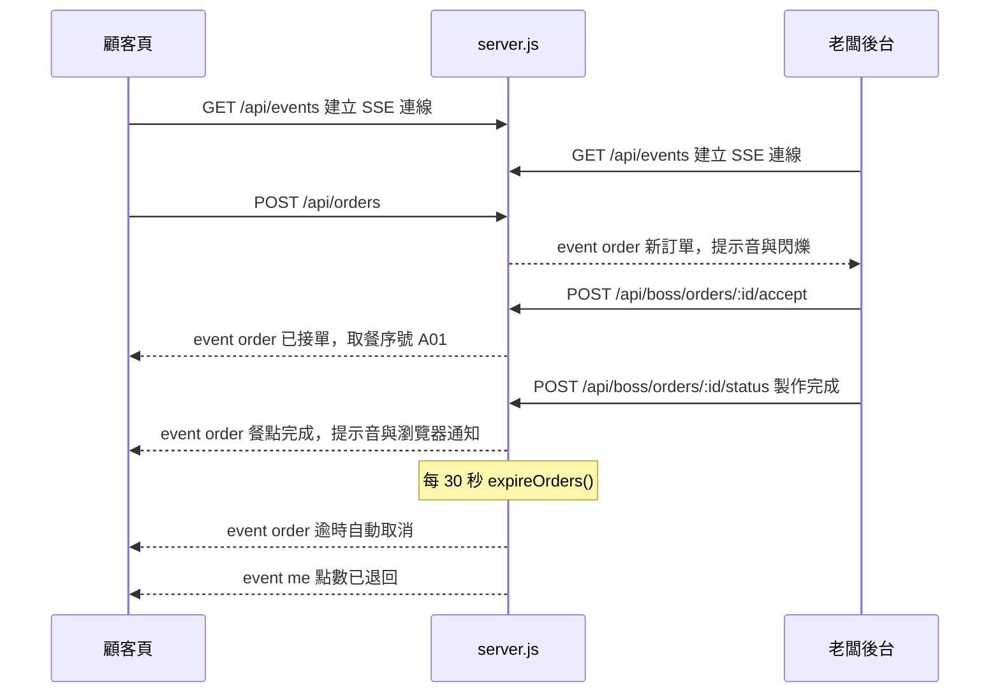
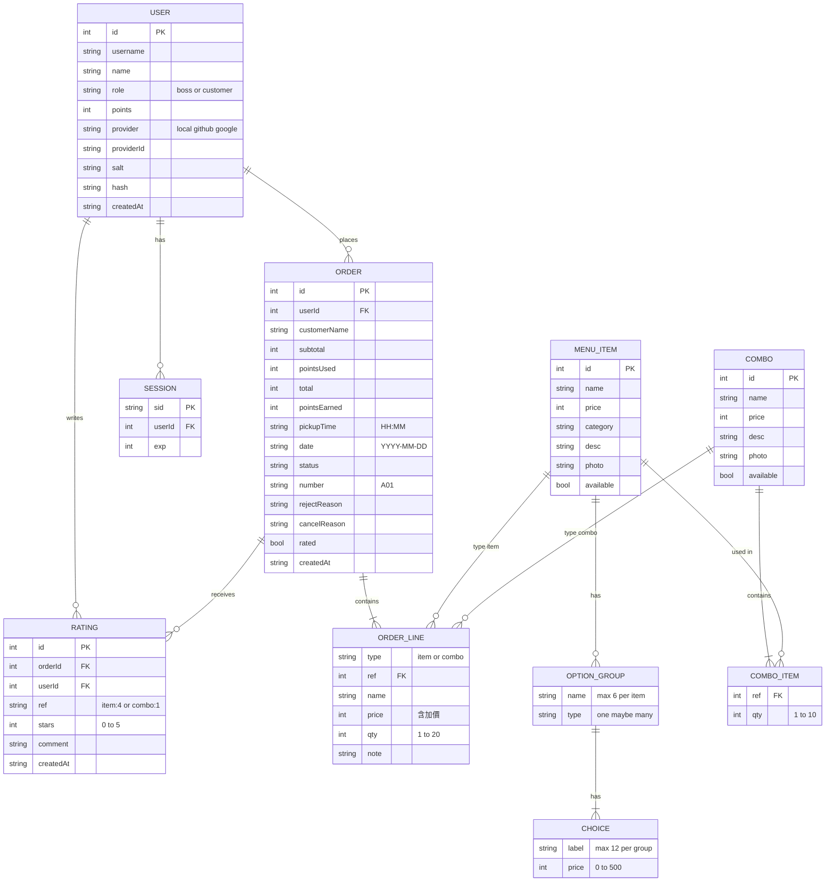
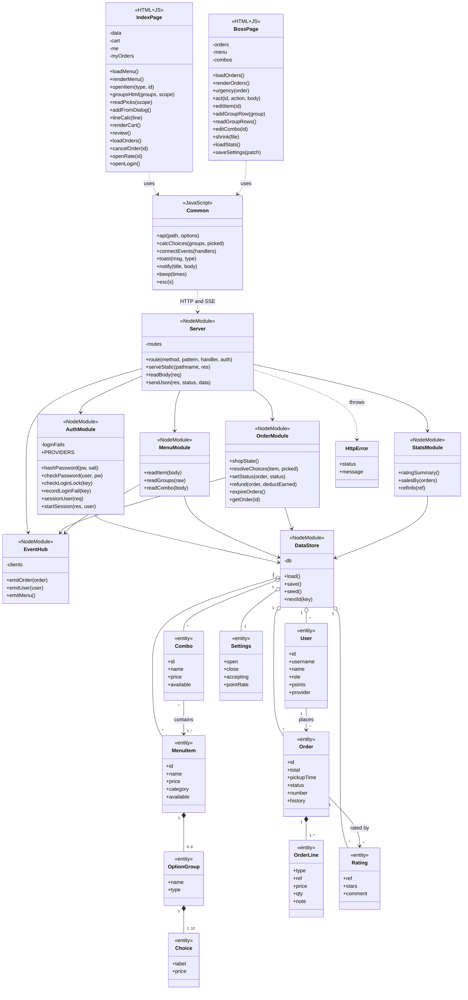

# 軟體設計文件(SDD)

- 專案名稱：北寧路早餐店 線上點餐與製作管理系統
- 撰寫日期：2026/10/26
- 發展者：〔請填入所有組員姓名〕
- 對應文件：專案需求規格文件（SRD）Iteration 2，0.2 版（2026/10/27）

---

## 版次變更記錄

| 版次 | 變更項目 | 變更日期 |
| --- | -------- | -------- |
| 0.1 | 原文記載已完成 MVP；原始文件版號與改版日期未提供 | 2026/10/13 |
| 0.2 | 原文件所載功能與實作說明 | 2026/10/27 |
| 0.3 |  |  |
| 1.0 |  |  |

---

## 目錄

1. 系統模型與架構 (System Model / System Architecture)
2. 介面需求與設計 (Interface Requirement and Design)
3. 流程設計 (Process Design)
4. 使用者畫面設計 (User Interface Design)
5. 資料設計 (Data Design)
6. 類別圖設計 (Class Diagram)
7. 實作方案 (Implementation Languages and Platforms)
8. 設計議題 (Design Issue)

---

## 1. 系統模型與架構 (System Model / System Architecture)

本系統為前後端分離的響應式 Web 系統，以 C4 model 的 Container diagram 表達，與 SRD 附錄「5.1 系統架構」一致。

- **顧客點餐頁** `/`（`index.html`）與**老闆後台** `/boss`（`boss.html`）：在瀏覽器執行，共用 `common.js`（API 呼叫、選項計價、推播連線、通知）與 `style.css`（設計系統）。
- **Web 伺服器** `server.js`：以 Node.js 內建 `http` 模組實作，同時提供靜態網頁、REST 風格 JSON API、Server-Sent Events 推播，並以計時器每 30 秒執行逾時訂單檢查。
- **資料儲存**：`data.json` 存放業務資料，`uploads/` 存放餐點照片。
- **外部系統**：GitHub、Google OAuth 2.0（第三方登入，選用）。



**部署環境**：目前為單一主機部署，於本機執行 `node server.js`（預設 `http://localhost:3000`），伺服器、`data.json` 與 `uploads/` 位於同一台主機。營業時間、取餐序號與統計一律以台北時區（Asia/Taipei）計算。對外服務時需設定 `BASE_URL`，並以反向代理提供 HTTPS（見第 7 節）。

---

## 2. 介面需求與設計 (Interface Requirement and Design)

介面使用者為前端頁面中的模組，介面提供者為 `server.js` 中的模組，連結方式為 HTTP。寫入類請求一律以 `Content-Type: application/json` 送出，身分以 HttpOnly cookie `sid` 辨識。各小節標題註明對應的 SRD 功能需求編號。

### 2.1 帳號與登入（FR-1）

| 介面名稱 | 介面提供者 | 介面使用者 | 連結方式 | 輸入資料 | 輸出資料 | 介面描述 |
| --- | --- | --- | --- | --- | --- | --- |
| 註冊 | 帳號模組 | 顧客頁（登入對話框） | POST /api/register | username、password、name | 使用者資料、Set-Cookie | 帳號 3–20 個英數字或底線、密碼至少 6 字元、暱稱 20 字內；帳號重複回 409 |
| 登入 | 帳號模組 | 顧客頁、老闆後台 | POST /api/login | username、password | 使用者資料、Set-Cookie | 建立 7 天 Session；同一來源 IP 對同一帳號 10 分鐘內失敗 5 次回 429 並暫時鎖定 |
| 登出 | 帳號模組 | 顧客頁、老闆後台 | POST /api/logout | — | `{ok:true}` | 刪除 Session 並清除 cookie |
| 目前使用者 | 帳號模組 | 顧客頁、老闆後台 | GET /api/me | cookie | 使用者資料或 null | 判斷登入狀態與角色 |
| 第三方登入設定 | 帳號模組 | 顧客頁（登入對話框） | GET /api/auth/providers | — | 各提供者是否啟用 | 未設定時按鈕顯示為停用 |
| 第三方登入 | 帳號模組 | 顧客頁 | GET /auth/:provider、GET /auth/:provider/callback | OAuth code、state | 302 轉址回首頁、Set-Cookie | GitHub／Google OAuth 2.0 授權碼流程，以 state cookie 防偽造 |

### 2.2 菜單與評價（FR-2、FR-8）

| 介面名稱 | 介面提供者 | 介面使用者 | 連結方式 | 輸入資料 | 輸出資料 | 介面描述 |
| --- | --- | --- | --- | --- | --- | --- |
| 取得菜單 | 菜單模組 | 顧客頁 `loadMenu()` | GET /api/menu | — | 營業狀態、上架餐點（含選項群組）、上架套餐（含各品項選項群組）、評分摘要、本月熱門前 3 名 | 不需登入 |
| 取得評論 | 統計與評價模組 | 顧客頁 `openItem()` | GET /api/ratings/:ref | ref（如 `item:4`、`combo:1`） | 最近 30 則評論，姓名只顯示第一個字 | 品項對話框顯示評論 |

### 2.3 顧客訂單（FR-4～FR-8）

| 介面名稱 | 介面提供者 | 介面使用者 | 連結方式 | 輸入資料 | 輸出資料 | 介面描述 |
| --- | --- | --- | --- | --- | --- | --- |
| 送出訂單 | 訂單模組 | 顧客頁 `review()` | POST /api/orders | items[type, ref, qty, choices 或 parts]、pickupTime、usePoints | 訂單（狀態：待接單、number 為 null） | 伺服器依選項群組重新計價，檢查營業時間、取餐時間、數量 1–20、點數；成功回 201 |
| 我的訂單 | 訂單模組 | 顧客頁 `loadOrders()` | GET /api/my/orders | — | 最近 50 筆訂單 | 「我的訂單」進度條 |
| 顧客取消 | 訂單模組 | 顧客頁 `cancelOrder()` | POST /api/orders/:id/cancel | 訂單 id | 訂單 | 僅限待接單，退回使用的點數 |
| 評價 | 統計與評價模組 | 顧客頁 `openRate()` | POST /api/orders/:id/rate | ratings[ref, stars 0–5, comment 200 字內] | 訂單（rated 為 true） | 製作完成或已取餐後可評價，每筆訂單一次 |

### 2.4 即時推播（FR-7、FR-9）

| 介面名稱 | 介面提供者 | 介面使用者 | 連結方式 | 輸入資料 | 輸出資料 | 介面描述 |
| --- | --- | --- | --- | --- | --- | --- |
| 事件串流 | 即時推播模組 | common.js `connectEvents()` | GET /api/events（text/event-stream） | cookie | `order`、`me`、`menu` 事件 | 訂單變動推給老闆與該顧客；點數變動推給本人；菜單或設定變動推給所有連線；每 25 秒送心跳 |

### 2.5 老闆後台（FR-9～FR-14）

| 介面名稱 | 介面提供者 | 介面使用者 | 連結方式 | 輸入資料 | 輸出資料 | 介面描述 |
| --- | --- | --- | --- | --- | --- | --- |
| 查詢訂單 | 訂單模組 | 後台 `loadOrders()` | GET /api/boss/orders | — | 今日訂單與所有未結束訂單 | 訂單看板資料 |
| 接單 | 訂單模組 | 後台 `act()` | POST /api/boss/orders/:id/accept | 訂單 id | 訂單（含序號 A01…） | 序號每日重編；取餐時間已過則拒絕並觸發逾時取消 |
| 拒絕 | 訂單模組 | 後台 `reject()` | POST /api/boss/orders/:id/reject | reason（50 字內） | 訂單 | 拒絕原因顯示給顧客，退回點數 |
| 更新進度 | 訂單模組 | 後台 `setSt()` | POST /api/boss/orders/:id/status | status：製作完成或已取餐 | 訂單 | 只允許「已接單→製作完成→已取餐」；已取餐時發放點數 |
| 老闆取消 | 訂單模組 | 後台 `cancelOrder()` | POST /api/boss/orders/:id/cancel | 訂單 id | 訂單 | 已拒絕、已取消以外皆可取消；退回使用點數並扣回已發點數 |
| 餐點管理 | 菜單模組 | 後台 `editItem()`、`delItem()` | GET、POST /api/boss/menu；PUT、DELETE /api/boss/menu/:id | 名稱、單價、分類、說明、groups、照片、上架狀態 | 餐點 | 選項群組最多 6 組、每組最多 12 個選項、加價 0–500；被套餐使用的餐點不可刪除 |
| 套餐管理 | 菜單模組 | 後台 `editCombo()`、`delCombo()` | POST /api/boss/combos；PUT、DELETE /api/boss/combos/:id | 名稱、價格、說明、items[ref, qty]、照片、上架狀態 | 套餐 | 套餐內每項數量 1–10 |
| 上傳照片 | 菜單模組 | 後台 `bindPhoto()` | POST /api/boss/upload | dataUrl（前端已縮圖的 base64） | 照片網址 | PNG／JPG／WEBP／GIF，解碼後 2 MB 內，檔名隨機 |
| 營業設定 | 設定模組 | 後台 `saveSettings()` | GET、PUT /api/boss/settings | open、close、accepting、pointRate | 設定 | 打烊需晚於開店；點數門檻 1–1000 元 |
| 銷售統計 | 統計與評價模組 | 後台 `loadStats()` | GET /api/boss/stats?range=today、month、all | range | 有效訂單數、營業額、客單價、點數折抵、銷售排行、各狀態數、評價分布 | 有效訂單為已接單、製作完成、已取餐 |

### 2.6 後端內部介面

| 介面名稱 | 介面提供者 | 介面使用者 | 連結方式 | 輸入資料 | 輸出資料 | 介面描述 |
| --- | --- | --- | --- | --- | --- | --- |
| 選項計價 | 訂單模組 `resolveChoices()` | 送出訂單路由 | 函式呼叫 | 餐點、顧客選擇 | 加價金額、明細文字、整理後選擇 | 驗證必選、單選、複選規則 |
| 逾時取消 | 訂單模組 `expireOrders()` | 計時器、接單路由 | 函式呼叫（每 30 秒） | — | — | 取消取餐時間已到的待接單訂單並退點、推播 |
| 存檔 | 資料存取模組 `save()` | 所有寫入路由 | 函式呼叫 | 記憶體中的 db | data.json | 先寫 `data.json.tmp` 再改名 |
| 推播 | 即時推播模組 `emitOrder()`、`emitUser()`、`emitMenu()` | 訂單、菜單、設定模組 | 函式呼叫 | 訂單、使用者 | SSE 事件 | 依角色與使用者決定對象 |

### 2.7 錯誤回應

所有 API 發生錯誤時回傳 `{ "error": "訊息" }`：400 資料錯誤、401 未登入、403 權限不足、404 找不到、409 帳號重複、413 資料太大（4 MB）、415 非 JSON、429 登入鎖定、500 伺服器錯誤。

---

## 3. 流程設計 (Process Design)

### 3.1 顧客點餐流程（Activity Diagram，對應 OC-01）



### 3.2 老闆接單與出餐流程（Activity Diagram，對應 OC-02）



### 3.3 訂單狀態（State Transition Diagram）



規則說明：

- 顧客只能取消「待接單」；老闆可取消「已拒絕」「已取消」以外的訂單，包含「已取餐」（見設計議題 6）。
- 「已接單」「製作完成」「已取餐」計入銷售統計（有效訂單）。
- 「製作完成」或「已取餐」後顧客可評價一次（見設計議題 6）。
- 待接單訂單距離取餐 10 分鐘內，後台卡片顯示紅色提醒。

### 3.4 即時通知流程（Sequence Diagram，對應 FR-7、FR-9、FR-10）



---

## 4. 使用者畫面設計 (User Interface Design)

本節為 SRD「使用者介面分析」UI-01～UI-09 的進階設計。

### 4.1 視覺設計原則

採用「北寧路晨光」設計系統，營造溫暖的早餐店氛圍：

| 項目 | 設計 |
| --- | --- |
| 主色 | 煎蛋橘 `#C2410C`：主要按鈕、頂部列、已選選項 |
| 輔色 | 吐司棕 `#92400E`：次要按鈕、分類標題；蛋黃 `#F59E0B`：熱門標籤、星等、鍵盤焦點外框；生菜綠 `#15803D`：成功狀態 |
| 背景與文字 | 奶油白 `#FFF8EC`、焙茶棕 `#3B2314` |
| 字型 | 標題：粉圓體 Huninn；內文：Noto Sans TC；價格數字：Nunito（等寬數字） |
| 元件 | 膠囊按鈕（高度至少 44px）、膠囊狀選項晶片、圓角 16px 卡片、暖棕色陰影 |
| 無障礙 | 文字對比度皆達 WCAG AA 4.5:1；鍵盤操作有明顯外框；支援減少動態效果 |
| 響應式 | 820px 以下：菜單兩欄、購物車改為底部浮動列；後台表格改為卡片、分頁列可左右滑動 |

### 4.2 顧客端畫面

| 編號 | 畫面 | 說明 |
| --- | --- | --- |
| UI-01 | 〔插入截圖〕登入與註冊 | 帳號密碼登入、註冊切換、GitHub／Google 登入按鈕；錯誤訊息顯示於對話框內 |
| UI-02 | 〔插入截圖〕菜單頁 | 頂部顯示營業狀態；餐點依分類以卡片呈現，含照片、價格、評分與「本月熱門」標籤 |
| UI-03 | 〔插入截圖〕品項與套餐對話框 | 選項群組以晶片按鈕呈現（單選、可不選、複選，加價顯示在選項上）；套餐逐項列出內含餐點的選項；「加入訂單」按鈕即時顯示含加價金額；下方為星等分布與評論 |
| UI-04 | 〔插入截圖〕購物車與確認視窗 | 一頁式購物車：數量加減、取餐時間（下單後至少 15 分鐘，每 5 分鐘一格）、點數折抵、小計與總計；送出前確認視窗列出明細 |
| UI-05 | 〔插入截圖〕我的訂單 | 狀態標籤、進度條、大字取餐序號、拒絕或取消原因；可取消（待接單）或評價 |

### 4.3 老闆後台畫面

| 編號 | 畫面 | 說明 |
| --- | --- | --- |
| UI-06 | 〔插入截圖〕訂單看板 | 待接單、製作清單、待取餐、今日已結束；新訂單提示音與閃爍；10 分鐘內未接單顯示紅色提醒 |
| UI-07 | 〔插入截圖〕餐點、套餐與營業設定 | 餐點表單含照片上傳與選項群組編輯（群組名稱、選擇方式、選項與加價）；套餐表單顯示單點合計；設定頁含營業時間、接單開關、點數門檻 |
| UI-08 | 〔插入截圖〕銷售統計 | 今日／本月／全部切換；營業額、有效訂單數、客單價、點數折抵、各分類銷售排行、評價表 |
| UI-09 | 〔插入截圖〕手機版介面 | 顧客頁兩欄菜單與底部購物車列；後台表格改卡片、分頁列可滑動 |

---

## 5. 資料設計 (Data Design)

本系統未使用資料庫，資料以 JSON 檔 `data.json` 儲存。伺服器啟動時整份讀入記憶體，每次資料變更後整份寫回（先寫暫存檔再改名）。啟動時若發現舊版欄位 `options`，會自動轉換為選項群組 `groups`。

### 5.1 資料實體關係（ER 圖）



說明：

- `OPTION_GROUP`、`CHOICE`、`COMBO_ITEM` 內嵌於上層物件中，沒有獨立 id。
- `ORDER_LINE` 複製下單當下的品名與含加價單價，之後老闆改價或刪除餐點，舊訂單不受影響。
- 單點的選擇記在 `ORDER_LINE.choices`（群組名稱 → 選項陣列）；套餐記在 `parts`（每個內含品項一組 choices）。
- `RATING.ref` 以「類型:編號」字串同時指向單點或套餐。
- `settings` 為單一物件：營業時間、接單開關、點數門檻。

### 5.2 檔案結構

```
breakfast-shop/
├── server.js          後端：HTTP 伺服器、API、SSE、OAuth、逾時檢查、資料存取
├── data.json          執行資料（首次啟動自動產生，不納入版本控制）
├── uploads/           餐點照片（檔名為隨機 24 碼十六進位）
├── public/
│   ├── index.html     顧客點餐頁
│   ├── boss.html      老闆後台
│   ├── common.js      前端共用：api()、calcChoices()、connectEvents()、toast()、notify()
│   └── style.css      設計系統與全站樣式
├── docs/
│   └── SDD.md         本文件
├── README.md          執行說明、需求對照、API 清單
└── .gitignore
```

### 5.3 JSON 結構

`data.json` 最上層結構：

```json
{
  "seq": { "user": 2, "menu": 6, "combo": 1, "order": 0, "rating": 0 },
  "settings": { "open": "06:00", "close": "21:00", "accepting": true, "pointRate": 30 },
  "users": [],
  "menu": [],
  "combos": [],
  "orders": [],
  "ratings": [],
  "sessions": {}
}
```

餐點（含選項群組）範例：

```json
{
  "id": 3,
  "name": "火腿蛋吐司",
  "price": 40,
  "category": "漢堡吐司",
  "desc": "火腿、荷包蛋與吐司",
  "groups": [
    { "name": "加料", "type": "many", "choices": [{ "label": "加蛋", "price": 10 }, { "label": "加起司", "price": 10 }] },
    { "name": "吐司", "type": "maybe", "choices": [{ "label": "去邊", "price": 0 }, { "label": "加厚片", "price": 5 }] }
  ],
  "photo": "",
  "available": true
}
```

訂單範例：

```json
{
  "id": 12,
  "userId": 2,
  "customerName": "示範同學",
  "items": [
    {
      "type": "item", "ref": 3, "name": "火腿蛋吐司", "price": 55, "qty": 1,
      "note": "加蛋+10、加厚片+5",
      "choices": { "加料": ["加蛋"], "吐司": ["加厚片"] }
    },
    {
      "type": "combo", "ref": 1, "name": "早八套餐", "price": 65, "qty": 1,
      "note": "奶茶：少冰、半糖",
      "parts": [{}, { "冰塊": ["少冰"], "甜度": ["半糖"] }]
    }
  ],
  "subtotal": 120,
  "pointsUsed": 5,
  "total": 115,
  "pointsEarned": 0,
  "pickupTime": "07:45",
  "date": "2026-10-26",
  "status": "已接單",
  "number": "A03",
  "rejectReason": "",
  "rated": false,
  "createdAt": "2026-10-25T23:20:11.000Z",
  "history": [
    { "status": "待接單", "at": "2026-10-25T23:20:11.000Z" },
    { "status": "已接單", "at": "2026-10-25T23:21:40.000Z" }
  ]
}
```

---

## 6. 類別圖設計 (Class Diagram)

本系統以 JavaScript 函式與物件實作，除 `HttpError` 外沒有宣告 class。以下以 stereotype 表示程式模組：`<<HTML+JS>>` 為前端頁面、`<<JavaScript>>` 為共用腳本、`<<NodeModule>>` 為 `server.js` 內的模組（依職責分組的函式）、`<<entity>>` 為 `data.json` 中的資料物件。



職責說明：

- **Server**：唯一進入點，依 URL 找到路由，檢查登入與角色（customer／boss／任一登入者），解析 JSON 後呼叫處理函式；錯誤統一以 `HttpError` 回應。
- **OrderModule**：`resolveChoices()` 驗證選項並計算加價；所有狀態變更經過 `setStatus()` 以記錄歷程；`expireOrders()` 由計時器每 30 秒呼叫。
- **MenuModule**：`readGroups()` 檢查選項群組數量、選擇方式、重複名稱與加價範圍。
- **AuthModule**：密碼雜湊、Session、登入失敗計數與 OAuth。
- **EventHub**：維護 SSE 連線，依角色與使用者決定推播對象。
- **DataStore**：讀寫 `data.json`、首次建立示範資料、舊版資料轉換。
- **Common.calcChoices()**：前端以和後端相同的規則即時計算含加價金額，最終金額仍以伺服器計算為準。

---

## 7. 實作方案 (Implementation Languages and Platforms)

- 平台：響應式 Web 網站，支援手機與電腦瀏覽器
- 前端技術與框架：原生 HTML、CSS、JavaScript（未使用框架）；`fetch` 呼叫 API、`<dialog>` 對話框、`EventSource` 接收推播；CSS 以 design tokens（CSS 自訂屬性）管理配色、字型與間距
- 後端技術與框架：Node.js 18 以上，只使用內建模組 `http`、`fs`、`path`、`crypto`，第三方登入使用內建 `fetch`；不需 `npm install`
- 主要函式庫與服務：
  - Server-Sent Events：即時推播
  - Web Notifications API、Web Audio：通知與提示音
  - scrypt（Node.js `crypto`）：密碼加鹽雜湊
  - OAuth 2.0：GitHub、Google 第三方登入（選用）
  - Google Fonts：Huninn、Noto Sans TC、Nunito
- 資料儲存：JSON 檔（`data.json`）與本機資料夾（`uploads/`）
- 版本控制：Git，原始碼置於 GitHub（AlvinHii/breakfast-ordering-system）
- 部署方式：目前為自架伺服器，在本機執行 `node server.js`。對外開放時可部署至雲端 PaaS 或虛擬機，設定 `PORT`、`BASE_URL`、`BOSS_PASSWORD` 與 OAuth 環境變數，以反向代理提供 HTTPS，並將 `data.json`、`uploads/` 放在持久化磁碟。
- 後續規劃（SRD 5.4）：改用 MongoDB 或 PostgreSQL；前端改用 React 或 Vue 搭配 Tailwind CSS。

---

## 8. 設計議題 (Design Issue)

### 議題 1：取餐序號產生時機

- 議題內容(Issue)：取餐序號在顧客送出時產生，還是老闆接單時產生。
- 背景(Context)：Iteration 1 為送出後立即取號（US-04）；Iteration 2 加入老闆接單與拒絕。
- 考量方案(Alternatives)：
  1. 送出時產生序號，被拒絕的序號作廢。
  2. 老闆接單時才產生序號。
- 決策與理由(Decision and Rationale)：採用方案 2（FR-5）。被拒絕或逾時取消的訂單不占用序號，當日序號連續，叫號不會跳號。
- 後果(Consequences)：顧客送出後先看到「訂購成功、等待店家接單」，接單通知時才取得序號；US-04 的測試方法需改為驗證接單後才有序號。

### 議題 2：客製選項的資料模型

- 議題內容(Issue)：如何表達加料、冰塊、甜度等不同性質的選項。
- 背景(Context)：Iteration 1 只有飲料冰熱的單一下拉選單；Iteration 2 需要可加價、可複選的選項，套餐內的餐點也要能各自選擇（FR-3）。
- 考量方案(Alternatives)：
  1. 每道餐點一份平面選項清單。
  2. 選項群組：每組有選擇方式（one 單選必選、maybe 單選可不選、many 複選），選項可加價。
- 決策與理由(Decision and Rationale)：採用方案 2。三種選擇方式涵蓋冰塊、吐司、加料等情境；套餐直接引用內含餐點的群組，不必另外設定。
- 後果(Consequences)：前端 `calcChoices()` 與後端 `resolveChoices()` 的計價方式必須一致，選擇規則的最終檢查在後端；購物車以「品項＋選擇」判斷是否為同一列；舊資料需在啟動時轉換格式。每道餐點最多 6 組、每組最多 12 個選項，避免畫面過長。

### 議題 3：資料儲存方式

- 議題內容(Issue)：資料存在資料庫還是檔案。
- 背景(Context)：課程時程有限，系統以展示為主，希望組員與老師能直接執行。
- 考量方案(Alternatives)：
  1. 關聯式資料庫（MySQL、PostgreSQL）。
  2. 雲端服務（Firebase）。
  3. 單一 JSON 檔，啟動時載入記憶體。
- 決策與理由(Decision and Rationale)：採用方案 3。不需安裝資料庫或申請帳號，刪除 `data.json` 即可重置示範資料。為降低檔案損毀風險，存檔時先寫 `data.json.tmp` 再改名。
- 後果(Consequences)：無法多台伺服器同時執行；資料量大時整份寫檔會變慢。SRD 已將資料庫列為後續規劃。

### 議題 4：即時通知技術

- 議題內容(Issue)：如何讓老闆即時收單、顧客即時收到狀態變更。
- 背景(Context)：Iteration 1 以 3～4 秒輪詢，有延遲且浪費請求（FR-7、FR-9）。
- 考量方案(Alternatives)：
  1. 繼續輪詢。
  2. WebSocket。
  3. Server-Sent Events。
- 決策與理由(Decision and Rationale)：採用方案 3。通知只需伺服器到瀏覽器的單向傳輸；SSE 用一般 HTTP、Node.js 內建模組即可實作，瀏覽器斷線會自動重連。
- 後果(Consequences)：每個開啟的頁面占用一條連線；伺服器每 25 秒送心跳避免被中斷。

### 議題 5：逾時未接單的處理

- 議題內容(Issue)：老闆一直沒有接單，取餐時間到了怎麼辦。
- 背景(Context)：顧客已扣除折抵點數，訂單卡在「待接單」會讓顧客空等（FR-10）。
- 考量方案(Alternatives)：
  1. 由老闆手動處理。
  2. 伺服器定期檢查並自動取消。
  3. 每次有請求時才檢查。
- 決策與理由(Decision and Rationale)：採用方案 2，每 30 秒檢查一次，另在伺服器啟動與老闆接單時立即檢查。自動取消時退回點數並推播通知顧客；後台在 10 分鐘內未接單時顯示紅色提醒，提醒老闆處理。
- 後果(Consequences)：取消時間最多延遲 30 秒；老闆無法接受取餐時間已過的訂單。

### 議題 6：評價開放時點與已取餐訂單取消（回應 SRD 待確認事項 1、2）

- 議題內容(Issue)：評價要在製作完成還是已取餐後開放；已取餐的訂單能否取消。
- 背景(Context)：SRD 的角色描述寫「取餐後評價」，FR-8 寫「餐點完成後」；FR-6 提到取消已取餐訂單會扣回點數，但狀態圖把已取餐當作終點。
- 考量方案(Alternatives)：
  1. 評價只在已取餐後開放；已取餐不可取消。
  2. 評價在製作完成後即開放；老闆可取消已取餐訂單，用於退款或誤按。
- 決策與理由(Decision and Rationale)：目前程式採用方案 2〔理由請組內確認後修改〕。可能的理由：老闆若忘記按「已取餐」，只在已取餐後開放會讓顧客無法評價；取消已取餐訂單可處理退款與誤按，並扣回已發點數以避免重複得點。
- 後果(Consequences)：被取消的已取餐訂單不再計入銷售統計；SRD 的角色描述與 5.2 狀態圖需配合修正（本文件 3.3 已加入「已取餐 → 已取消」）。此決策仍待組內確認。

### 議題 7：價格與點數的信任邊界

- 議題內容(Issue)：訂單金額、加價、取餐時間與點數由誰計算。
- 背景(Context)：前端資料可被竄改，例如修改請求中的價格或選項。
- 考量方案(Alternatives)：
  1. 前端計算後送出總金額。
  2. 前端只送品項、數量與選項名稱，伺服器重新查價並驗證。
- 決策與理由(Decision and Rationale)：採用方案 2（SRD 安全性需求）。伺服器依菜單與選項群組重算單價，檢查營業時間、取餐時間、選項規則、數量 1–20 與點數餘額；前端計算僅供即時顯示。
- 後果(Consequences)：前後端各有一份計價邏輯需同步維護，但金額無法被竄改。

### 議題 8：登入失敗鎖定的識別方式（回應 NFR-08）

- 議題內容(Issue)：「同一台裝置」要如何識別。
- 背景(Context)：SRD 要求同一台裝置對同一帳號 10 分鐘內失敗 5 次即鎖定 10 分鐘，但未定義裝置識別方式。
- 考量方案(Alternatives)：
  1. 以 cookie 識別裝置。
  2. 以連線來源 IP 加帳號識別。
- 決策與理由(Decision and Rationale)：採用方案 2。攻擊者可以清除 cookie 繞過方案 1；以 IP 加帳號計數不需額外儲存，計數保存在記憶體中。
- 後果(Consequences)：同一網路（同一個對外 IP）的多台裝置會共用計數；伺服器重啟後計數歸零。若部署於反向代理之後，需改用代理提供的真實來源 IP。
