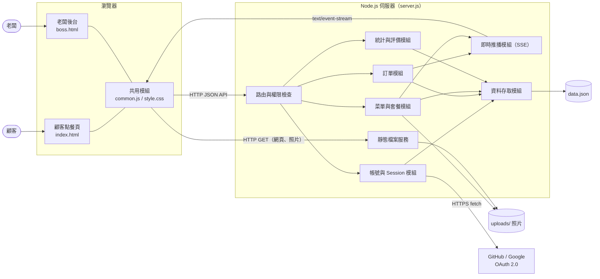
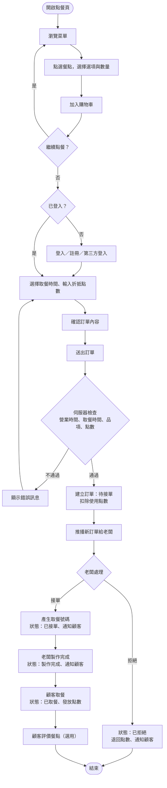
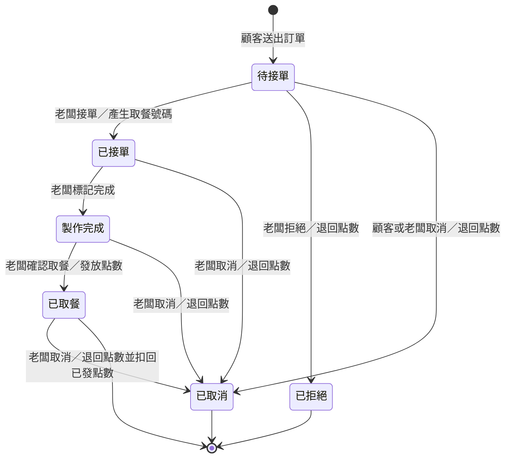
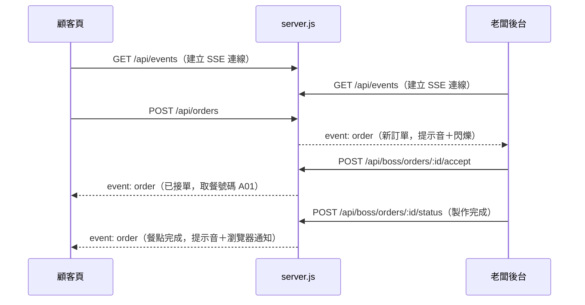
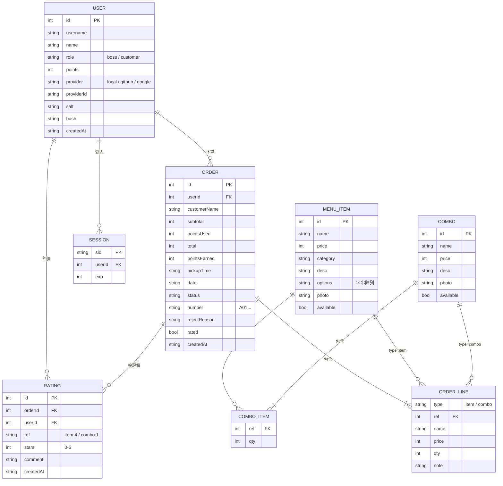
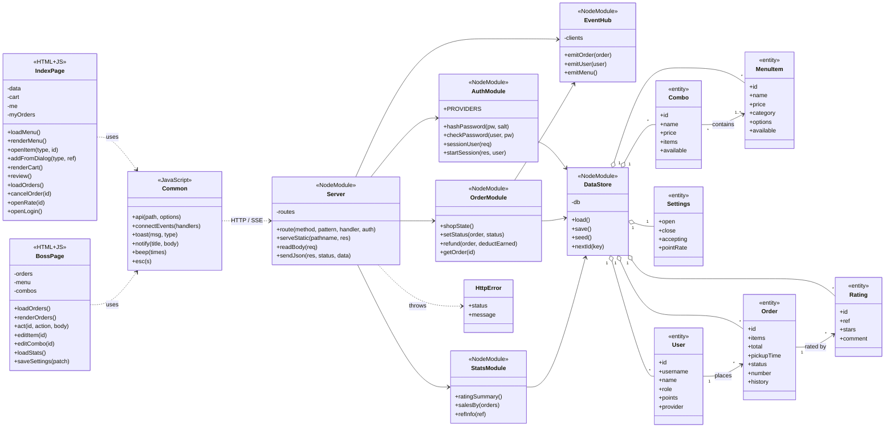

# 軟體設計文件(SDD)

- 專案名稱：北寧路早餐店線上點餐系統
- 撰寫日期：2026/11/14
- 發展者：〔請填入所有組員姓名〕

---

## 版次變更記錄

| 版次 | 變更項目 | 變更日期 |
| --- | -------- | -------- |
| 0.1 | 初版：依實作程式碼整理系統架構、介面、流程、畫面、資料、類別圖、實作方案與設計議題 | 2026/10/26 |
| 0.2 |  |  |
| 0.3 |  |  |
| 1.0 |  |  |

---

## 目錄

1. 系統模型與架構 (System Model / System Architecture)
2. 介面需求與設計 (Interface Requirement and Design)
3. 流程設計 (Process Design)
4. 使用者畫面設計 (User Interface Design)
5. 資料設計 (Data Design)
6. 類別圖設計 (Class Diagram)
7. 實作方案 (Implementation Languages and Platforms)
8. 設計議題 (Design Issue)

---

## 1. 系統模型與架構 (System Model / System Architecture)

本系統為前後端分離的 Web 系統，採 C4 model 的 Container diagram 表達。系統分為三個部分：

- **顧客點餐頁**（`index.html`）與**老闆後台**（`boss.html`）：在瀏覽器執行，共用 `common.js`（API 呼叫、推播連線、通知）與 `style.css`。
- **Web 伺服器**（`server.js`）：以 Node.js 內建 `http` 模組實作，同時負責提供靜態網頁、REST API 與即時推播（Server-Sent Events）。
- **資料儲存**：`data.json` 存放所有業務資料，`uploads/` 存放餐點照片。

外部系統為 GitHub 與 Google 的 OAuth 2.0 服務（第三方登入，選用）。



**部署環境**：目前部署於單一台電腦（`node server.js`，預設 `http://localhost:3000`）。伺服器與資料檔在同一台主機上，瀏覽器透過 HTTP 連線。若要對外提供服務，需設定 `BASE_URL` 並以反向代理提供 HTTPS（見第 7 節）。

---

## 2. 介面需求與設計 (Interface Requirement and Design)

介面使用者為前端頁面中的模組，介面提供者為後端 `server.js` 中的模組，連結方式為 HTTP。所有寫入類請求須以 `Content-Type: application/json` 送出，身分以 HttpOnly cookie `sid` 辨識。

### 2.1 帳號與登入

| 介面名稱 | 介面提供者 | 介面使用者 | 連結方式 | 輸入資料 | 輸出資料 | 介面描述 |
| --- | --- | --- | --- | --- | --- | --- |
| 註冊 | 帳號模組 | 顧客頁（登入對話框） | POST /api/register | username、password、name | 使用者資料，並設定 cookie | 建立顧客帳號（帳號 3–20 英數字，密碼至少 6 字元） |
| 登入 | 帳號模組 | 顧客頁、老闆後台 | POST /api/login | username、password | 使用者資料，並設定 cookie | 驗證密碼並建立 7 天 Session |
| 登出 | 帳號模組 | 顧客頁、老闆後台 | POST /api/logout | — | `{ok:true}` | 刪除 Session 與 cookie |
| 取得目前使用者 | 帳號模組 | 顧客頁、老闆後台 | GET /api/me | cookie | 使用者資料或 null | 頁面載入時判斷登入狀態與角色 |
| 查詢第三方登入 | 帳號模組 | 顧客頁（登入對話框） | GET /api/auth/providers | — | 各提供者是否已設定 | 未設定時按鈕顯示為停用 |
| 第三方登入 | 帳號模組 | 顧客頁 | GET /auth/:provider → callback | OAuth code、state | 轉址回首頁並設定 cookie | GitHub / Google OAuth 2.0 授權碼流程 |

### 2.2 菜單與評價（不需登入）

| 介面名稱 | 介面提供者 | 介面使用者 | 連結方式 | 輸入資料 | 輸出資料 | 介面描述 |
| --- | --- | --- | --- | --- | --- | --- |
| 取得菜單 | 菜單模組 | 顧客頁（菜單區） | GET /api/menu | — | 營業狀態、上架餐點、套餐、評分摘要、本月熱門 | 顧客瀏覽完整菜單 |
| 取得餐點評論 | 統計與評價模組 | 顧客頁（品項對話框） | GET /api/ratings/:ref | ref（如 `item:4`） | 最近 30 則評論（姓名遮蔽） | 顯示該餐點評論 |

### 2.3 顧客訂單

| 介面名稱 | 介面提供者 | 介面使用者 | 連結方式 | 輸入資料 | 輸出資料 | 介面描述 |
| --- | --- | --- | --- | --- | --- | --- |
| 下單 | 訂單模組 | 顧客頁（購物車） | POST /api/orders | items[type, ref, qty, note]、pickupTime、usePoints | 訂單（狀態：待接單） | 伺服器重新計算價格並檢查營業時間、取餐時間、點數 |
| 查詢我的訂單 | 訂單模組 | 顧客頁（我的訂單） | GET /api/my/orders | — | 最近 50 筆訂單 | 顯示訂單狀態與進度 |
| 取消訂單 | 訂單模組 | 顧客頁（我的訂單） | POST /api/orders/:id/cancel | 訂單 id | 更新後的訂單 | 僅限待接單；退回使用的點數 |
| 評價訂單 | 統計與評價模組 | 顧客頁（評價對話框） | POST /api/orders/:id/rate | ratings[ref, stars 0–5, comment] | 更新後的訂單 | 製作完成或已取餐後可評價一次 |

### 2.4 即時推播

| 介面名稱 | 介面提供者 | 介面使用者 | 連結方式 | 輸入資料 | 輸出資料 | 介面描述 |
| --- | --- | --- | --- | --- | --- | --- |
| 事件串流 | 即時推播模組 | common.js `connectEvents()` | GET /api/events（SSE） | cookie | `order`、`me`、`menu` 事件 | 訂單變動推給老闆與該顧客；點數變動推給本人；菜單變動推給所有人 |

### 2.5 老闆後台

| 介面名稱 | 介面提供者 | 介面使用者 | 連結方式 | 輸入資料 | 輸出資料 | 介面描述 |
| --- | --- | --- | --- | --- | --- | --- |
| 查詢訂單 | 訂單模組 | 老闆後台（訂單頁） | GET /api/boss/orders | — | 今日與未結束的訂單 | 訂單看板資料 |
| 接單 | 訂單模組 | 老闆後台（訂單頁） | POST /api/boss/orders/:id/accept | 訂單 id | 訂單（含取餐號碼） | 產生當日序號 A01、A02… |
| 拒絕 | 訂單模組 | 老闆後台（訂單頁） | POST /api/boss/orders/:id/reject | reason | 訂單 | 拒絕並退回點數 |
| 更新狀態 | 訂單模組 | 老闆後台（訂單頁） | POST /api/boss/orders/:id/status | status（製作完成／已取餐） | 訂單 | 已取餐時發放點數 |
| 取消訂單 | 訂單模組 | 老闆後台（訂單頁） | POST /api/boss/orders/:id/cancel | 訂單 id | 訂單 | 退回使用的點數並扣回已發放點數 |
| 餐點管理 | 菜單模組 | 老闆後台（餐點頁） | GET / POST /api/boss/menu、PUT / DELETE /api/boss/menu/:id | 名稱、單價、分類、說明、選項、照片、上架狀態 | 餐點資料 | 新增、修改、上下架、刪除（被套餐使用時不可刪） |
| 套餐管理 | 菜單模組 | 老闆後台（套餐頁） | POST /api/boss/combos、PUT / DELETE /api/boss/combos/:id | 名稱、價格、說明、items[ref, qty]、照片 | 套餐資料 | 新增、修改、刪除套餐 |
| 上傳照片 | 菜單模組 | 老闆後台（餐點／套餐表單） | POST /api/boss/upload | dataUrl（base64 圖片） | 照片網址 | 限 PNG/JPG/WEBP/GIF，2 MB 以內 |
| 營業設定 | 設定模組 | 老闆後台（設定頁） | GET / PUT /api/boss/settings | open、close、accepting、pointRate | 設定值 | 營業時間、暫停接單、點數門檻 |
| 銷售統計 | 統計與評價模組 | 老闆後台（統計頁） | GET /api/boss/stats?range= | today / month / all | 營業額、客單價、排行、評價分布 | 銷售報表 |

### 2.6 錯誤回應

所有 API 發生錯誤時回傳 `{ "error": "訊息" }`，狀態碼為 400（資料錯誤）、401（未登入）、403（權限不足）、404（找不到）、409（帳號重複）、413（資料太大）、415（非 JSON）、500（伺服器錯誤）。

---

## 3. 流程設計 (Process Design)

### 3.1 顧客點餐流程（Activity Diagram）



### 3.2 訂單狀態（State Transition Diagram）



規則說明：

- 顧客只能取消「待接單」的訂單；老闆可取消「已拒絕」「已取消」以外的訂單。
- 「已接單」「製作完成」「已取餐」三種狀態才計入銷售統計。
- 「製作完成」或「已取餐」後，顧客可以評價一次。

### 3.3 即時通知流程（Sequence Diagram）



---

## 4. 使用者畫面設計 (User Interface Design)

### 4.1 視覺設計原則

採用「北寧路晨光」設計系統，以溫暖的早餐店氛圍為主：

| 項目 | 設計 |
| --- | --- |
| 主色 | 煎蛋橘 `#C2410C`（主要按鈕、頂部列） |
| 輔色 | 吐司棕 `#92400E`（次要按鈕、分類標題）、蛋黃 `#F59E0B`（熱門標籤、星等）、生菜綠 `#15803D`（成功狀態） |
| 背景／文字 | 奶油白 `#FFF8EC`／焙茶棕 `#3B2314` |
| 字型 | 標題：粉圓體 Huninn；內文：Noto Sans TC；價格數字：Nunito |
| 元件 | 膠囊按鈕（高度至少 44px）、圓角 16px 卡片、暖棕色陰影 |
| 無障礙 | 文字對比度皆達 WCAG AA 4.5:1、鍵盤操作有明顯外框、支援減少動態效果 |
| 響應式 | 820px 以下改為兩欄菜單，購物車改為底部浮動列 |

### 4.2 顧客端畫面

| 畫面 | 說明 |
| --- | --- |
| 〔插入截圖〕菜單頁 | 頂部顯示營業狀態；餐點依分類以卡片呈現，含照片、價格、評分與「本月熱門」標籤；桌機版右側為購物車 |
| 〔插入截圖〕品項對話框 | 餐點說明、客製選項（冰量）、數量加減、評分分布與顧客評論，按「加入訂單」放入購物車 |
| 〔插入截圖〕購物車與確認 | 品項數量調整、取餐時間（下單後至少 15 分鐘，每 5 分鐘一格）、點數折抵、小計與總計，送出前顯示確認對話框 |
| 〔插入截圖〕我的訂單 | 每筆訂單顯示狀態標籤、進度條（待接單→已接單→製作完成→已取餐）、取餐號碼，可取消（待接單）或評價 |
| 〔插入截圖〕登入／註冊 | 帳號密碼登入、註冊切換，以及 GitHub / Google 登入按鈕 |
| 〔插入截圖〕評價對話框 | 對訂單內每項餐點打 0–5 星並留言 |

### 4.3 老闆後台畫面

| 畫面 | 說明 |
| --- | --- |
| 〔插入截圖〕訂單看板 | 三欄：待接單、製作中、待取餐；新訂單有提示音與閃爍；可接單、拒絕（填原因）、標記完成、確認取餐 |
| 〔插入截圖〕餐點管理 | 表格列出餐點，可新增、編輯（含照片上傳與客製選項）、上下架、刪除 |
| 〔插入截圖〕套餐管理 | 選擇組成餐點與數量，顯示單點合計以便訂價 |
| 〔插入截圖〕銷售統計 | 今日／本月／全部切換；營業額、訂單數、客單價、各餐點銷售排行、評價星等分布 |
| 〔插入截圖〕設定 | 營業時間、暫停接單開關、點數門檻（每多少元 1 點） |

---

## 5. 資料設計 (Data Design)

本系統未使用資料庫，所有資料以單一 JSON 檔 `data.json` 儲存。伺服器啟動時讀入記憶體，每次資料變更後整份寫回。

### 5.1 資料實體關係（ER 圖）



說明：

- `ORDER_LINE` 會複製下單當下的品名與單價，之後老闆改價格或刪除餐點，舊訂單內容不受影響。
- `RATING.ref` 以「類型:編號」字串同時指向單點或套餐。
- `ORDER.history` 記錄每次狀態變更的時間（見 5.3）。

### 5.2 檔案結構

```
breakfast-shop/
├── server.js          後端：HTTP 伺服器、API、SSE、OAuth、資料存取
├── data.json          執行資料（首次啟動自動產生，不納入版本控制）
├── uploads/           餐點照片（檔名為隨機 24 碼十六進位）
├── public/
│   ├── index.html     顧客點餐頁
│   ├── boss.html      老闆後台
│   ├── common.js      前端共用：api()、toast()、notify()、connectEvents()
│   └── style.css      設計系統與全站樣式
├── docs/
│   └── SDD.md         本文件
├── README.md          執行說明、需求對照、API 清單
└── .gitignore
```

### 5.3 JSON 結構

`data.json` 最上層結構：

```json
{
  "seq": { "user": 2, "menu": 6, "combo": 1, "order": 0, "rating": 0 },
  "settings": { "open": "06:00", "close": "21:00", "accepting": true, "pointRate": 30 },
  "users": [],
  "menu": [],
  "combos": [],
  "orders": [],
  "ratings": [],
  "sessions": {}
}
```

訂單物件範例：

```json
{
  "id": 12,
  "userId": 2,
  "customerName": "示範同學",
  "items": [
    { "type": "combo", "ref": 1, "name": "早八套餐", "price": 65, "qty": 1, "note": "" },
    { "type": "item", "ref": 4, "name": "奶茶", "price": 25, "qty": 1, "note": "少冰" }
  ],
  "subtotal": 90,
  "pointsUsed": 5,
  "total": 85,
  "pointsEarned": 0,
  "pickupTime": "07:45",
  "date": "2026-11-14",
  "status": "已接單",
  "number": "A03",
  "rejectReason": "",
  "rated": false,
  "createdAt": "2026-11-13T23:20:11.000Z",
  "history": [
    { "status": "待接單", "at": "2026-11-13T23:20:11.000Z" },
    { "status": "已接單", "at": "2026-11-13T23:21:40.000Z" }
  ]
}
```

---

## 6. 類別圖設計 (Class Diagram)

本系統以 JavaScript 函式與物件實作，除 `HttpError` 外沒有宣告 class。以下用 stereotype 表示程式模組：`<<NodeModule>>` 為後端模組、`<<HTML+JS>>` 為前端頁面、`<<JavaScript>>` 為共用腳本、`<<entity>>` 為 `data.json` 內的資料物件。



職責說明：

- **Server**：唯一的進入點，依 URL 找到路由，檢查登入與角色（`customer` / `boss` / `user`），解析 JSON 後呼叫對應處理函式，錯誤統一轉成 `HttpError` 回應。
- **OrderModule**：訂單狀態轉換與點數退還，所有狀態變更都經過 `setStatus()` 以記錄歷程。
- **EventHub**：維護所有 SSE 連線，依角色與使用者決定推播對象。
- **DataStore**：負責讀寫 `data.json` 與首次啟動時建立示範資料。

---

## 7. 實作方案 (Implementation Languages and Platforms)

- 平台：Web 網站（桌機與手機瀏覽器皆可使用，響應式設計）
- 前端技術與框架：原生 HTML、CSS、JavaScript（未使用框架）；CSS 以 design tokens（CSS 自訂屬性）管理配色、字型與間距
- 後端技術與框架：Node.js 18 以上，只使用內建模組 `http`、`fs`、`path`、`crypto`，不需 `npm install`
- 主要函式庫與服務：
  - Server-Sent Events：即時推播訂單與菜單變動
  - Web Notifications API、Web Audio：顧客與老闆的通知與提示音
  - scrypt（Node.js `crypto`）：密碼加鹽雜湊
  - OAuth 2.0：GitHub、Google 第三方登入（選用）
  - Google Fonts：Huninn、Noto Sans TC、Nunito
- 資料儲存：JSON 檔案（`data.json`）與本機資料夾（`uploads/`）
- 版本控制：Git，原始碼放在 GitHub（AlvinHii/breakfast-ordering-system）
- 部署方式：目前為自架伺服器，在本機執行 `node server.js`。若要對外開放，可部署到雲端 PaaS 或 VM，設定 `PORT`、`BASE_URL`、`BOSS_PASSWORD` 與 OAuth 環境變數，並以反向代理提供 HTTPS；資料檔需放在持久化磁碟。

---

## 8. 設計議題 (Design Issue)

### 議題 1：取餐號碼在什麼時候產生

- 議題內容(Issue)：取餐號碼要在顧客送出訂單時產生，還是在老闆接單時產生。
- 背景(Context)：組員的使用者故事寫「送出訂單後產生取餐號碼」，但題目基本需求 #7 寫「訂單被接受時產生序號，並加入製作清單」。
- 考量方案(Alternatives)：
  1. 送出時產生號碼，被拒絕的訂單號碼作廢。
  2. 接單時才產生號碼。
- 決策與理由(Decision and Rationale)：採用方案 2，依照題目需求 #7。被拒絕的訂單不會占用號碼，當日號碼連續，老闆叫號時不會跳號。
- 後果(Consequences)：顧客送出後只會看到「訂購成功、等待店家接單」，要等接單通知才拿到號碼；使用者故事需同步修改。

### 議題 2：資料儲存方式

- 議題內容(Issue)：資料要存在資料庫還是檔案。
- 背景(Context)：課程時程有限，系統主要用於展示；希望組員和老師可以直接執行，不需要另外安裝資料庫。
- 考量方案(Alternatives)：
  1. 關聯式資料庫（MySQL、PostgreSQL）。
  2. 雲端服務（Firebase）。
  3. 單一 JSON 檔案，啟動時載入記憶體。
- 決策與理由(Decision and Rationale)：採用方案 3。不需安裝任何軟體或帳號，刪除 `data.json` 即可重置示範資料，方便展示與測試。
- 後果(Consequences)：無法同時執行多台伺服器；資料量大時每次整份寫檔會變慢；沒有交易機制，寫檔途中當機可能損壞資料。正式上線需改用資料庫（列於 README「尚未做」）。

### 議題 3：即時通知的技術

- 議題內容(Issue)：老闆收到新訂單、顧客收到接單與完成通知，要如何做到即時。
- 背景(Context)：題目要求老闆即時收單，以及「已接單」「餐點完成」通知顧客。
- 考量方案(Alternatives)：
  1. 前端定時輪詢（polling）。
  2. WebSocket。
  3. Server-Sent Events（SSE）。
- 決策與理由(Decision and Rationale)：採用方案 3。通知只需要伺服器推給瀏覽器的單向傳輸；SSE 用一般 HTTP 即可，Node.js 內建模組就能實作，瀏覽器斷線後也會自動重連。
- 後果(Consequences)：延遲低且不浪費請求；每個開著的頁面會占用一條連線，伺服器每 25 秒送出心跳避免連線被中斷。

### 議題 4：價格與點數的信任邊界

- 議題內容(Issue)：訂單金額、取餐時間、點數折抵要由誰計算。
- 背景(Context)：前端的資料可以被使用者竄改，例如修改請求中的價格。
- 考量方案(Alternatives)：
  1. 前端計算後送出總金額，伺服器直接存。
  2. 前端只送品項編號、數量、選項，伺服器重新查價並驗證。
- 決策與理由(Decision and Rationale)：採用方案 2。伺服器依菜單重新計算小計，並檢查營業時間、取餐時間（至少 15 分鐘後）、選項是否合法、數量 1–20、點數是否足夠；前端只做提示用的檢查。
- 後果(Consequences)：前後端各有一份檢查邏輯需要同步維護，但金額不會被竄改。

### 議題 5：不使用前端框架與 npm 套件

- 議題內容(Issue)：是否使用 React、Express 等框架。
- 背景(Context)：系統規模不大，組員需要能直接閱讀和修改程式。
- 考量方案(Alternatives)：
  1. 前端 React／Vue，後端 Express。
  2. 原生 JavaScript 與 Node.js 內建模組。
- 決策與理由(Decision and Rationale)：採用方案 2。不需要 `npm install` 或建置步驟，下載後執行 `node server.js` 即可，也沒有第三方套件的安全更新問題。
- 後果(Consequences)：路由、cookie、請求解析等功能要自己寫；畫面以字串組 HTML，需要自行做 HTML 跳脫（`esc()`）防止 XSS。若功能繼續擴充，維護成本會比使用框架高。
