# 軟體設計文件(SDD)

- 專案名稱：北寧路早餐店 線上點餐與製作管理系統
- 撰寫日期：2026/10/26
- 發展者：許能翔，陳科宇，林偉翔，江宗衡，簡誌均
- 對應文件：專案需求規格文件（SRD）Iteration 2，0.5 版（2026/11/17）

---

## 版次變更記錄

| 版次 | 變更項目 | 變更日期 |
| --- | -------- | -------- |
| 0.1 | 原文記載已完成 MVP | 2026/10/13 |
| 0.2 | 原文件所載功能與實作說明 | 2026/10/27 |
| 0.3 | Iteration 2：新增歷史訂單與營收報表（FR-15）、今日售完（FR-16）、再點一次（FR-17）、訂單備註（FR-18）的介面、畫面、資料與類別設計 | 2026/11/15 |
| 0.4 | 第 1 節更新 Render＋Neon、第 2／3 節補交易與提交後推播、第 5 節實體資料表及照片、第 6 節 Storage 類別、第 7 節部署及第 8 節新設計決策；保留既有介面、截圖與流程；新增項目統一歸入 Iteration 2 | 2026/11/17 |

---

## 目錄

第 5 節包含完整 SQL 建表定義；JSON 範例保留作為物件格式說明。

1. 系統模型與架構 (System Model / System Architecture)
2. 介面需求與設計 (Interface Requirement and Design)
3. 流程設計 (Process Design)
4. 使用者畫面設計 (User Interface Design)
5. 資料設計 (Data Design)
6. 類別圖設計 (Class Diagram)
7. 實作方案 (Implementation Languages and Platforms)
8. 設計議題 (Design Issue)

---

## 1. 系統模型與架構 (System Model / System Architecture)

目前前後端程式有介面與 API 分工，但由同一個 Node.js 服務提供靜態頁面與 API，屬單一部署服務，不描述為前後端各自獨立部署。

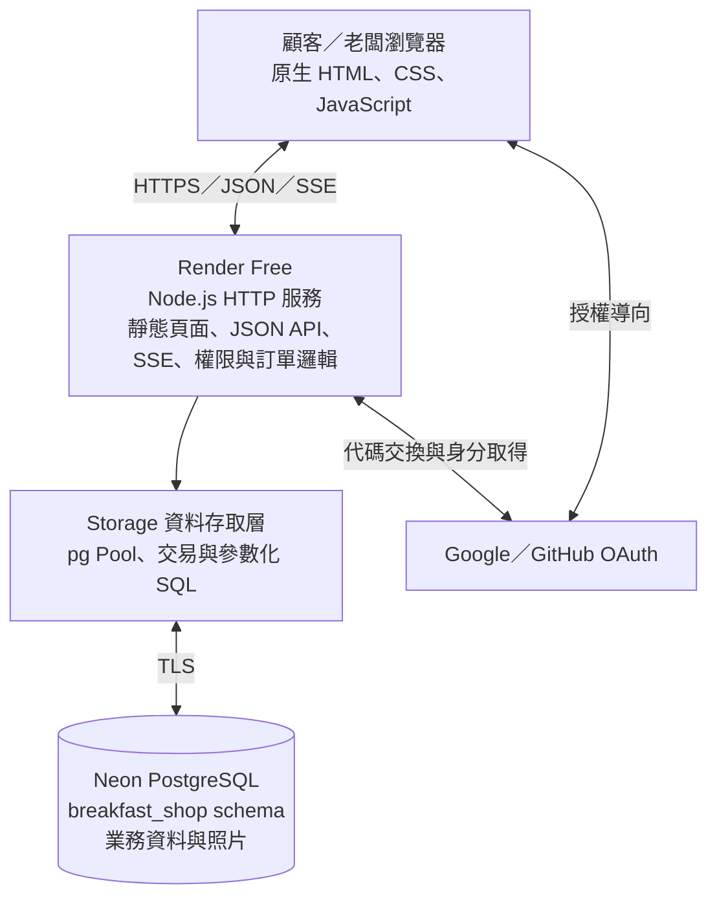

營業時間、取餐序號與統計以台北時區（Asia/Taipei）計算。

---

## 2. 介面需求與設計 (Interface Requirement and Design)

介面使用者為前端頁面中的模組，介面提供者為 `server.js` 中的模組，連結方式為 HTTP。寫入類請求一律以 `Content-Type: application/json` 送出，身分以 HttpOnly cookie `sid` 辨識。各小節標題註明對應的 SRD 功能需求編號。

### 2.1 帳號與登入（FR-1）

| 介面名稱 | 介面提供者 | 介面使用者 | 連結方式 | 輸入資料 | 輸出資料 | 介面描述 |
| --- | --- | --- | --- | --- | --- | --- |
| 註冊 | 帳號模組 | 顧客頁（登入對話框） | POST /api/register | username、password、name | 使用者資料、Set-Cookie | 帳號 3–20 個英數字或底線、密碼至少 6 字元、暱稱 20 字內；帳號重複回 409 |
| 登入 | 帳號模組 | 顧客頁、老闆後台 | POST /api/login | username、password | 使用者資料、Set-Cookie | 建立 7 天 Session；同一來源 IP 對同一帳號 10 分鐘內失敗 5 次回 429 並暫時鎖定 |
| 登出 | 帳號模組 | 顧客頁、老闆後台 | POST /api/logout | — | `{ok:true}` | 刪除 Session 並清除 cookie |
| 目前使用者 | 帳號模組 | 顧客頁、老闆後台 | GET /api/me | cookie | 使用者資料或 null | 判斷登入狀態與角色 |
| 第三方登入設定 | 帳號模組 | 顧客頁（登入對話框） | GET /api/auth/providers | — | 各提供者是否啟用 | 未設定時按鈕顯示為停用 |
| 第三方登入 | 帳號模組 | 顧客頁 | GET /auth/:provider、GET /auth/:provider/callback | OAuth code、state | 302 轉址回首頁、Set-Cookie | GitHub／Google OAuth 2.0 授權碼流程，以 state cookie 防偽造 |

### 2.2 菜單與評價（FR-2、FR-8）

| 介面名稱 | 介面提供者 | 介面使用者 | 連結方式 | 輸入資料 | 輸出資料 | 介面描述 |
| --- | --- | --- | --- | --- | --- | --- |
| 取得菜單 | 菜單模組 | 顧客頁 `loadMenu()` | GET /api/menu | — | 營業狀態、上架餐點（含選項群組）、上架套餐（含各品項選項群組）、評分摘要、本月熱門前 3 名 | 不需登入 |
| 取得評論 | 統計與評價模組 | 顧客頁 `openItem()` | GET /api/ratings/:ref | ref（如 `item:4`、`combo:1`） | 最近 30 則評論，姓名只顯示第一個字 | 品項對話框顯示評論 |

### 2.3 顧客訂單（FR-4～FR-8）

| 介面名稱 | 介面提供者 | 介面使用者 | 連結方式 | 輸入資料 | 輸出資料 | 介面描述 |
| --- | --- | --- | --- | --- | --- | --- |
| 送出訂單 | 訂單模組 | 顧客頁 `review()` | POST /api/orders | items[type, ref, qty, choices 或 parts]、pickupTime、usePoints、remark（選填，50 字內） | 訂單（狀態：待接單、number 為 null） | 伺服器依選項群組重新計價，檢查營業時間、取餐時間、數量 1–20、點數；成功回 201 |
| 我的訂單 | 訂單模組 | 顧客頁 `loadOrders()` | GET /api/my/orders | — | 最近 50 筆訂單 | 「我的訂單」進度條 |
| 顧客取消 | 訂單模組 | 顧客頁 `cancelOrder()` | POST /api/orders/:id/cancel | 訂單 id | 訂單 | 僅限待接單，退回使用的點數 |
| 評價 | 統計與評價模組 | 顧客頁 `openRate()` | POST /api/orders/:id/rate | ratings[ref, stars 0–5, comment 200 字內] | 訂單（rated 為 true） | 製作完成或已取餐後可評價，每筆訂單一次 |

### 2.4 即時推播（FR-7、FR-9）

| 介面名稱 | 介面提供者 | 介面使用者 | 連結方式 | 輸入資料 | 輸出資料 | 介面描述 |
| --- | --- | --- | --- | --- | --- | --- |
| 事件串流 | 即時推播模組 | common.js `connectEvents()` | GET /api/events（text/event-stream） | cookie | `order`、`me`、`menu` 事件 | 訂單變動推給老闆與該顧客；點數變動推給本人；菜單或設定變動推給所有連線；每 25 秒送心跳 |

### 2.5 老闆後台（FR-9～FR-16）

| 介面名稱 | 介面提供者 | 介面使用者 | 連結方式 | 輸入資料 | 輸出資料 | 介面描述 |
| --- | --- | --- | --- | --- | --- | --- |
| 查詢訂單 | 訂單模組 | 後台 `loadOrders()` | GET /api/boss/orders | — | 今日訂單與所有未結束訂單 | 訂單看板資料 |
| 接單 | 訂單模組 | 後台 `act()` | POST /api/boss/orders/:id/accept | 訂單 id | 訂單（含序號 A01…） | 序號每日重編；取餐時間已過則拒絕並觸發逾時取消 |
| 拒絕 | 訂單模組 | 後台 `reject()` | POST /api/boss/orders/:id/reject | reason（50 字內） | 訂單 | 拒絕原因顯示給顧客，退回點數 |
| 更新進度 | 訂單模組 | 後台 `setSt()` | POST /api/boss/orders/:id/status | status：製作完成或已取餐 | 訂單 | 只允許「已接單→製作完成→已取餐」；已取餐時發放點數 |
| 老闆取消 | 訂單模組 | 後台 `cancelOrder()` | POST /api/boss/orders/:id/cancel | 訂單 id | 訂單 | 已拒絕、已取消以外皆可取消；退回使用點數並扣回已發點數 |
| 餐點管理 | 菜單模組 | 後台 `editItem()`、`delItem()` | GET、POST /api/boss/menu；PUT、DELETE /api/boss/menu/:id | 名稱、單價、分類、說明、groups、照片、上架狀態 | 餐點 | 選項群組最多 6 組、每組最多 12 個選項、加價 0–500；被套餐使用的餐點不可刪除 |
| 今日售完 | 菜單模組 | 後台 `toggleSoldOut()` | POST /api/boss/menu/:id/soldout | soldOut（true／false） | 餐點（含 soldOutDate） | 寫入或清除今天的台北日期；`/api/menu` 回傳 soldOut 旗標，套餐內任一項售完即整個套餐 soldOut；下單時以 `isSoldOut()` 阻擋 |
| 套餐管理 | 菜單模組 | 後台 `editCombo()`、`delCombo()` | POST /api/boss/combos；PUT、DELETE /api/boss/combos/:id | 名稱、價格、說明、items[ref, qty]、照片、上架狀態 | 套餐 | 套餐內每項數量 1–10 |
| 上傳照片 | 菜單模組 | 後台 `bindPhoto()` | POST /api/boss/upload | dataUrl（前端已縮圖的 base64） | 照片網址 | PNG／JPG／WEBP／GIF，解碼後非空且 2 MB 內，檔名隨機，內容保存 PostgreSQL photos |
| 營業設定 | 設定模組 | 後台 `saveSettings()` | GET、PUT /api/boss/settings | open、close、accepting、pointRate | 設定 | 打烊需晚於開店；點數門檻 1–1000 元 |
| 銷售統計 | 統計與評價模組 | 後台 `loadStats()` | GET /api/boss/stats?range=today、month、all | range | 有效訂單數、營業額、客單價、點數折抵、銷售排行、各狀態數、評價分布 | 有效訂單為已接單、製作完成、已取餐 |
| 歷史報表 | 統計與評價模組 | 後台 `loadHistory()` | GET /api/boss/history?from=YYYY-MM-DD&to=YYYY-MM-DD | from、to | 區間摘要（有效訂單數、營業額、客單價、點數折抵、各狀態數）、每日營業額、訂單明細（最多 500 筆）與是否截斷 | 區間最多 366 天；日期格式錯誤或順序顛倒回 400；CSV 由前端 `historyCsv()` 依回傳明細產生 |

### 2.6 後端內部介面

| 介面名稱 | 介面提供者 | 介面使用者 | 連結方式 | 輸入資料 | 輸出資料 | 介面描述 |
| --- | --- | --- | --- | --- | --- | --- |
| 選項計價 | 訂單模組 `resolveChoices()` | 送出訂單路由 | 函式呼叫 | 餐點、顧客選擇 | 加價金額、明細文字、整理後選擇 | 驗證必選、單選、複選規則 |
| 逾時取消 | 訂單模組 `expireOrders()` | 計時器、接單路由 | 函式呼叫（每 30 秒） | — | — | 取消取餐時間已到的待接單訂單並退點、推播 |
| 存檔 | 資料存取模組 `save()` | 所有寫入路由 | 函式呼叫 | 記憶體中的 db | dirty 變更標記 | save() 僅標記變更；withState() 在交易成功時用 Storage.save() 更新異動列，提交後才回應 |
| 推播 | 即時推播模組 `emitOrder()`、`emitUser()`、`emitMenu()` | 訂單、菜單、設定模組 | 函式呼叫 | 訂單、使用者 | SSE 事件 | 依角色與使用者決定對象 |
| 資料庫交易 | Storage.transaction() | withState()、初始化、維護工具 | 非同步函式 | client callback | 提交結果或拋錯 | BEGIN、advisory_xact_lock、transaction-local search_path、COMMIT／ROLLBACK |
| 讀寫快照 | Storage.load()／save() | withState() | 非同步函式 | client、state、previous | 業務資料 | 查詢資料表，僅更新異動資料列；參數化 SQL |
| 照片保存與讀取 | Storage.putPhoto()／getPhoto() | 上傳路由／靜態服務 | 非同步函式 | 名稱、格式、Buffer | 圖片資料或 URL | 保留 /uploads/ 網址，資料來自 photos |

### 2.7 錯誤回應

所有 API 發生錯誤時回傳 `{ "error": "訊息" }`：400 資料錯誤、401 未登入、403 權限不足、404 找不到、409 帳號重複、413 資料太大（4 MB）、415 非 JSON、429 登入鎖定、500 伺服器錯誤。

### 2.8 健康檢查與設定狀態

GET /healthz 回應服務存活狀態，供 Render 健康檢查使用。/api/auth/providers 的 enabled 表示該提供者已設定金鑰。HTTPS 下 cookie 加上 Secure，session 保存於 PostgreSQL。

---

## 3. 流程設計 (Process Design)

### 3.1 顧客點餐流程（Activity Diagram，對應 OC-01）

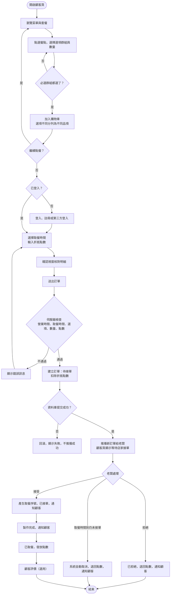

### 3.2 老闆接單與出餐流程（Activity Diagram，對應 OC-02）


### 3.3 訂單狀態（State Transition Diagram）

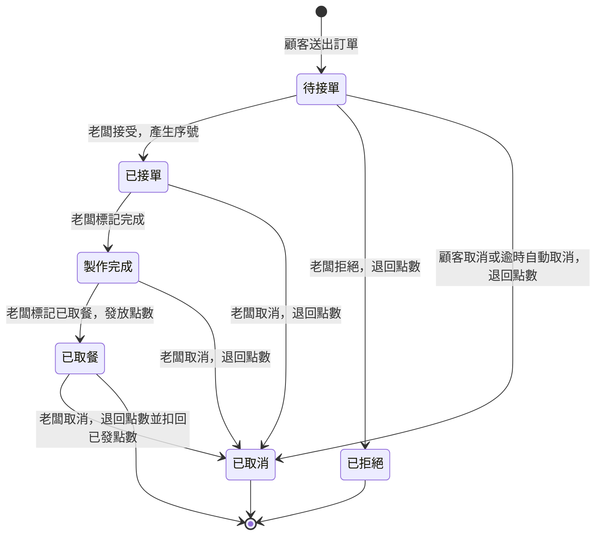

規則說明：

- 顧客只能取消「待接單」；老闆可取消「已拒絕」「已取消」以外的訂單，包含「已取餐」（見設計議題 6）。
- 「已接單」「製作完成」「已取餐」計入銷售統計（有效訂單）。
- 「製作完成」或「已取餐」後顧客可評價一次（見設計議題 6）。
- 待接單訂單距離取餐 10 分鐘內，後台卡片顯示紅色提醒。

### 3.4 即時通知流程（Sequence Diagram，對應 FR-7、FR-9、FR-10）

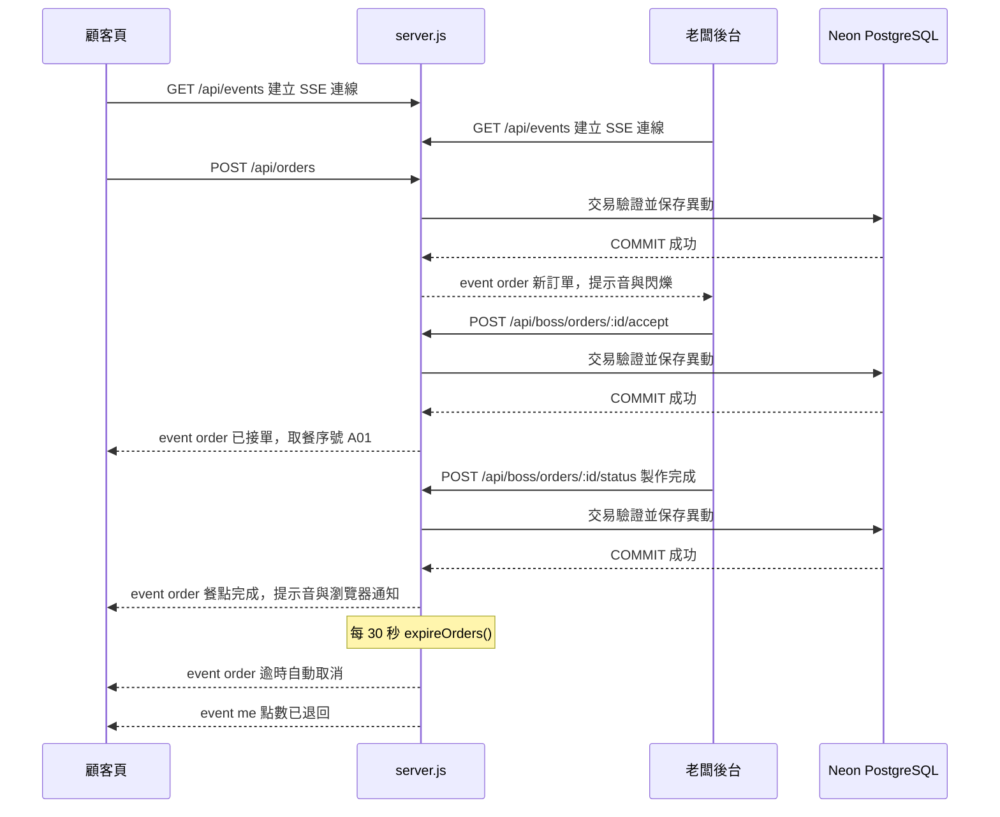

---

### 3.5 例外流程補充

| 情境 | 顧客端 | 老闆端／系統處理 |
|---|---|---|
| 已打烊、暫停接單或取餐時間不合法 | 顯示不可送單／時間錯誤，無成功訂單 | 後端再驗證營業狀態及時間；不僅依賴前端按鈕 |
| 食材用完 | 餐點及受影響套餐顯示今日售完，不能加入或送單 | 老闆標記售完；已放購物車的品項會移除，下單時再次檢查 |
| 時段額滿 | 系統沒有時段容量上限，不會顯示額滿 | 老闆可依實際產能拒單或暫停接單 |
| 店家拒單 | 顯示已拒絕與原因，退回已折抵點數 | 老闆填原因並拒絕；變更成功後通知顧客 |
| 顧客取消 | 僅待接單時可取消，顯示已取消 | 訂單不再可接，退回折抵點數 |
| 待接單逾時 | 顯示已取消並收到狀態更新 | 服務運作時定期檢查；過取餐時間不可再接受 |
| 老闆取消已取餐訂單 | 顯示已取消 | 退回折抵點數並扣回已發點數，不再列入有效銷售 |
| 送出後想改餐點 | 目前沒有直接編輯已送訂單功能 | 待接單可取消後重下，其他狀態聯絡店家 |
| 資料庫寫入失敗 | 回傳失敗，不應收到成功通知 | 交易回滾，不改回 JSON 或假示範資料繼續執行 |
| 網路中斷、送單結果不明 | 先恢復連線並查「我的訂單」再決定是否重送 | 系統沒有重複送單防護，手動重送可能建立兩筆訂單 |
| 瀏覽器未授權通知或限制音效 | 仍可查看頁面內訂單狀態 | 背景通知與音效依瀏覽器設定；SSE 斷線後自動重連 |
| 第三方登入未設定／授權失敗 | 未設定時按鈕停用；授權失敗需重新登入或改用帳密 | 核對平台設定、callback 與金鑰；不將金鑰放進前端 |
| Render 免費服務休眠 | 初次開啟需等待喚醒 | 休眠期間計時器、即時推播與逾時檢查暫停，喚醒後恢復 |

## 4. 使用者畫面設計 (User Interface Design)

本節為 SRD「使用者介面分析」UI-01～UI-11 的進階設計。

### 4.1 視覺設計原則

採用「北寧路早餐店」設計系統，營造溫暖的早餐店氛圍：

| 項目 | 設計 |
| --- | --- |
| 主色 | 煎蛋橘 `#C2410C`：主要按鈕、頂部列、已選選項 |
| 輔色 | 吐司棕 `#92400E`：次要按鈕、分類標題；蛋黃 `#F59E0B`：熱門標籤、星等、鍵盤焦點外框；生菜綠 `#15803D`：成功狀態 |
| 背景與文字 | 奶油白 `#FFF8EC`、焙茶棕 `#3B2314` |
| 字型 | 標題：粉圓體 Huninn；內文：Noto Sans TC；價格數字：Nunito（等寬數字） |
| 元件 | 膠囊按鈕（高度至少 44px）、膠囊狀選項晶片、圓角 16px 卡片、暖棕色陰影 |
| 無障礙 | 文字對比度目標為 WCAG AA 4.5:1；鍵盤操作有明顯外框；支援減少動態效果 |
| 響應式 | 820px 以下：菜單兩欄、購物車改為底部浮動列；後台表格改為卡片、分頁列可左右滑動 |

### 4.2 顧客端畫面

| 編號 | 畫面 | 說明 |
| --- | --- | --- |
| UI-01 | 登入與註冊 | 帳號密碼登入、註冊切換、GitHub／Google 登入按鈕；錯誤訊息顯示於對話框內 |
| UI-02 | 菜單頁 | 頂部顯示營業狀態；餐點依分類以卡片呈現，含照片、價格、評分與「本月熱門」標籤 |
| UI-03 | 品項與套餐對話框 | 選項群組以晶片按鈕呈現（單選、可不選、複選，加價顯示在選項上）；套餐逐項列出內含餐點的選項；「加入訂單」按鈕即時顯示含加價金額；下方為星等分布與評論 |
| UI-04 | 購物車與確認視窗 | 一頁式購物車：數量加減、取餐時間（下單後至少 15 分鐘，每 5 分鐘一格）、點數折抵、小計與總計；送出前確認視窗列出明細；訂單備註輸入框（顯示字數，確認視窗一併列出） |
| UI-05 | 我的訂單 | 狀態標籤、進度條、大字取餐序號、拒絕或取消原因；可取消（待接單）或評價；每筆訂單的「再點一次」依目前菜單以 `fitPicks()` 整理選項後加回購物車，略過下架或售完品項並以提示說明（FR-17） |

### 4.3 老闆後台畫面

| 編號 | 畫面 | 說明 |
| --- | --- | --- |
| UI-06 | 訂單看板 | 待接單、製作清單、待取餐、今日已結束；新訂單提示音與閃爍；10 分鐘內未接單顯示紅色提醒 |
| UI-07 | 餐點、套餐與營業設定 | 餐點表單含照片上傳與選項群組編輯（群組名稱、選擇方式、選項與加價）；套餐表單顯示單點合計；設定頁含營業時間、接單開關、點數門檻 |
| UI-08 | 銷售統計 | 今日／本月／全部切換；營業額、有效訂單數、客單價、點數折抵、各分類銷售排行、評價表 |
| UI-09 | 手機版介面 | 顧客頁兩欄菜單與底部購物車列；後台表格改卡片、分頁列可滑動 |
| UI-10 | 歷史報表 | 日期區間與快捷按鈕（近 7 天、近 30 天、本月、上月）；摘要數字、每日營業額長條、訂單明細表；右上角匯出 CSV |
| UI-11 | 今日售完 | 後台餐點列「今日售完／恢復供應」按鈕與狀態標籤、套餐「含售完餐點」；顧客菜單卡片灰階並標示「今日售完」，對話框停用加入 |

### 4.4 畫面截圖

以下截圖以示範資料拍攝（2026/11/15）。截圖中的 demo 帳號僅用於本機示範，公開網站已停用 demo 登入。

#### UI-01 登入與註冊

以示範帳號畫面為例：帳號密碼登入、切換註冊，下方為 GitHub／Google 登入（未設定時停用）。

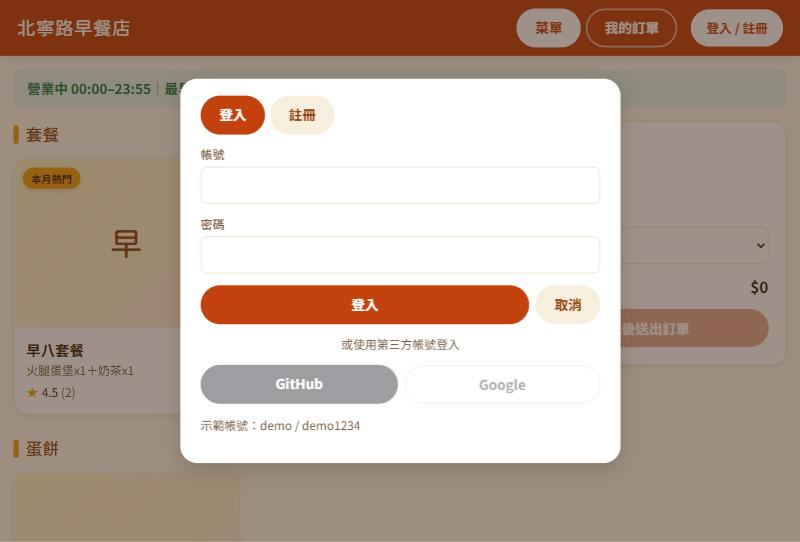

#### UI-02 菜單頁

頂部為營業狀態；餐點依分類以卡片呈現，標示「本月熱門」與平均評分；右側為一頁式購物車。

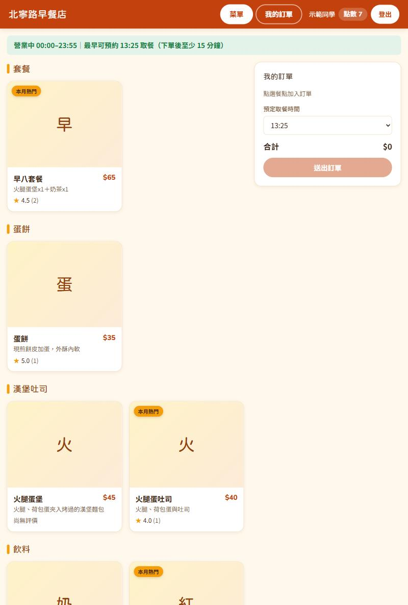

#### UI-03 品項與套餐對話框

早八套餐逐項列出火腿蛋堡與奶茶的選項群組；已選選項以煎蛋橘標示，加入按鈕即時顯示含加價金額。

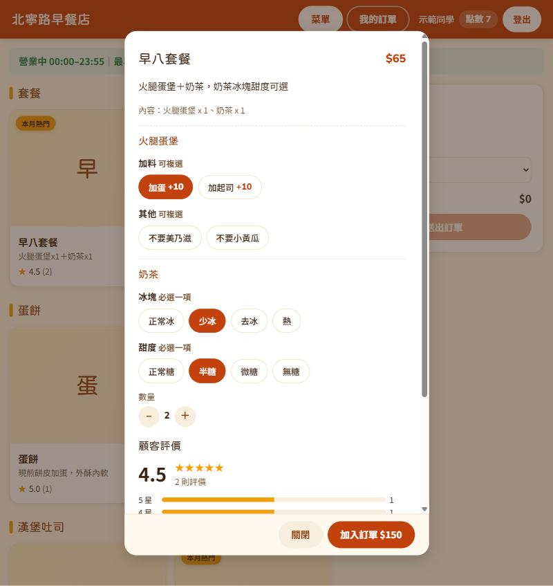

#### UI-04 購物車與確認視窗

購物車含選項明細、取餐時間、點數折抵與訂單備註（顯示字數）；送出前的確認視窗列出明細、折抵、取餐時間與備註。

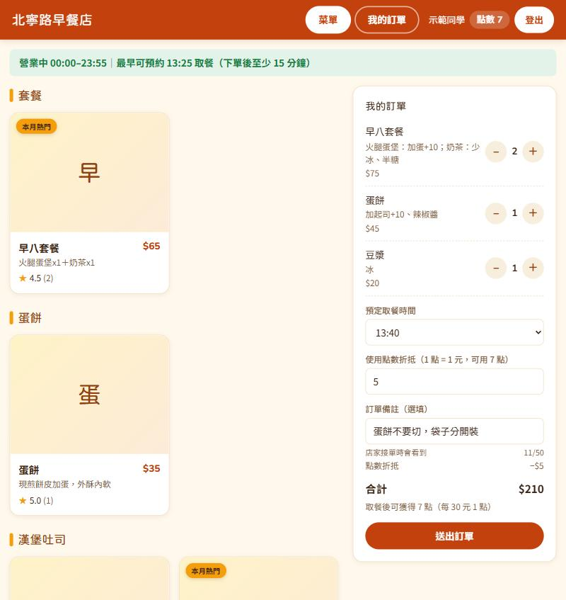
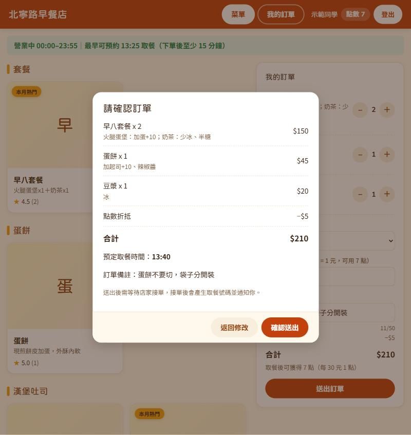

#### UI-05 我的訂單

手機版畫面：狀態標籤、進度條、取餐號碼、訂單備註，以及「取消訂單」「再點一次」按鈕。

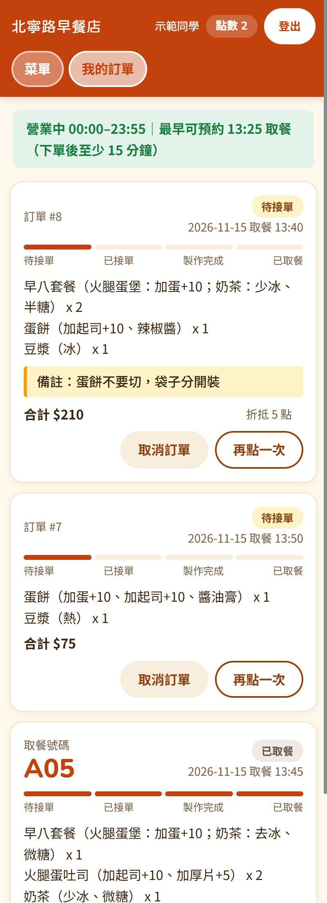

#### UI-06 訂單看板

待接單、製作清單、待取餐三欄；訂單卡顯示客製明細與備註，可接受、拒絕、標記製作完成與已取餐。

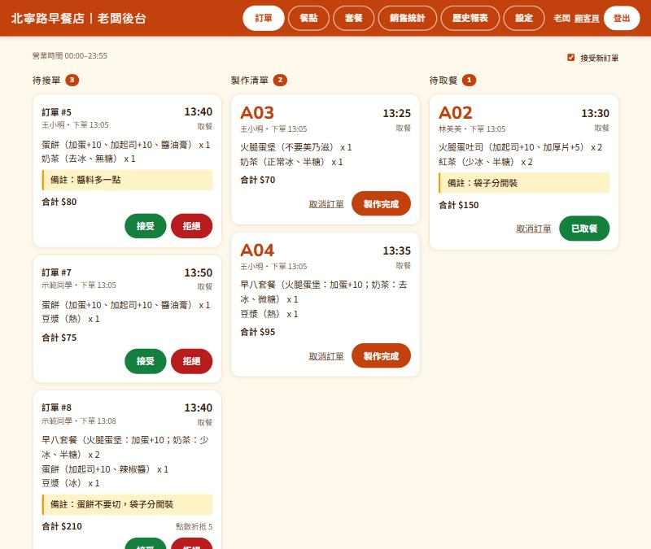

#### UI-07 餐點、套餐與營業設定

餐點列表顯示客製選項群組與狀態；編輯餐點時可設定選項群組名稱、選擇方式、選項與加價。

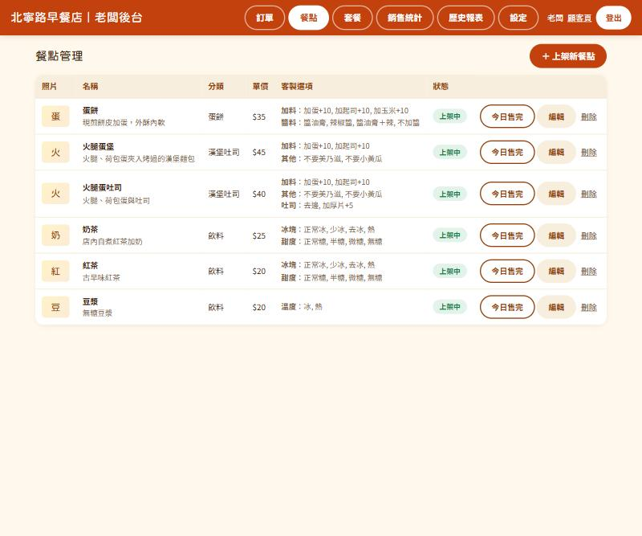
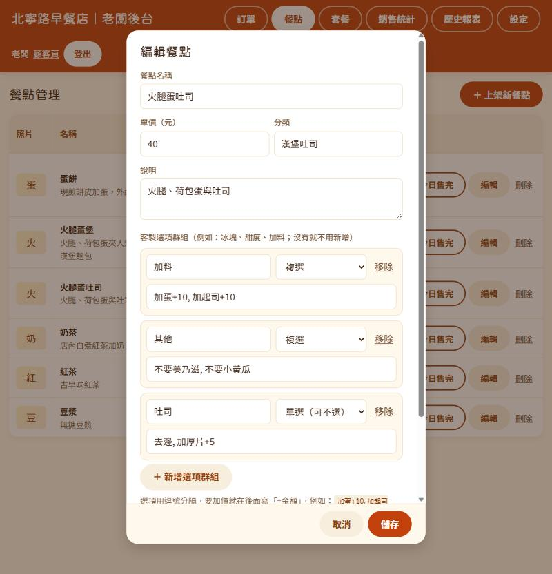

#### UI-08 銷售統計

今日／本月／全部切換；有效訂單、營業額、客單價、點數折抵，各分類銷售排行與餐點評價表。

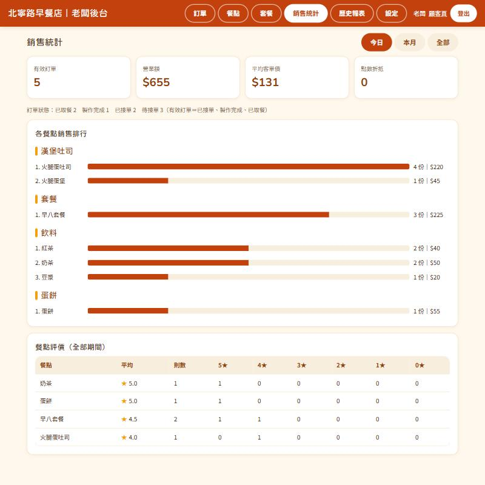

#### UI-09 手機版介面

顧客頁菜單與底部浮動購物車列；後台表格在窄螢幕改為卡片、分頁列可左右滑動。

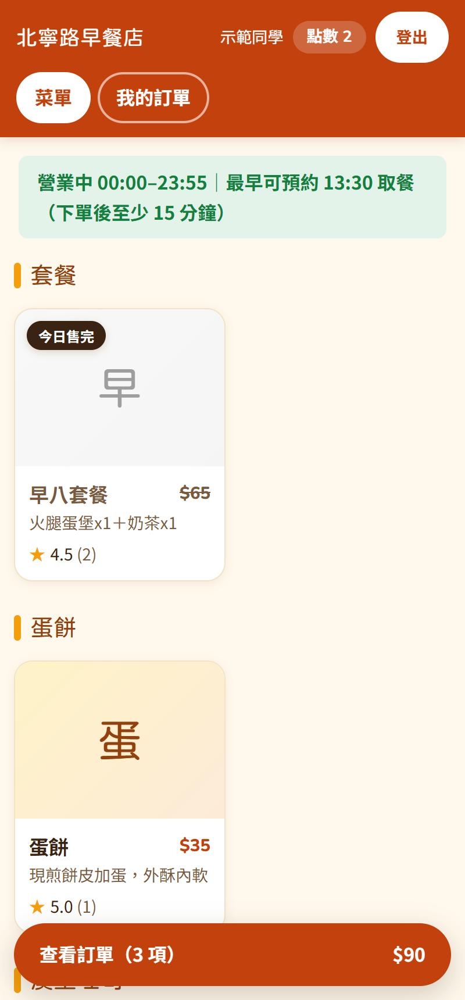
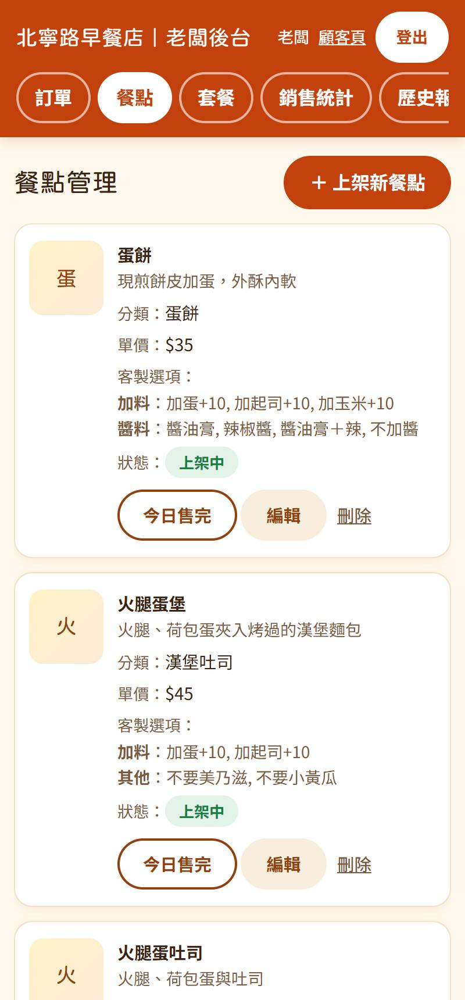

#### UI-10 歷史報表

以近 7 天為例：日期區間與快捷按鈕、摘要數字、每日營業額、訂單明細（含備註），右上角匯出 CSV。

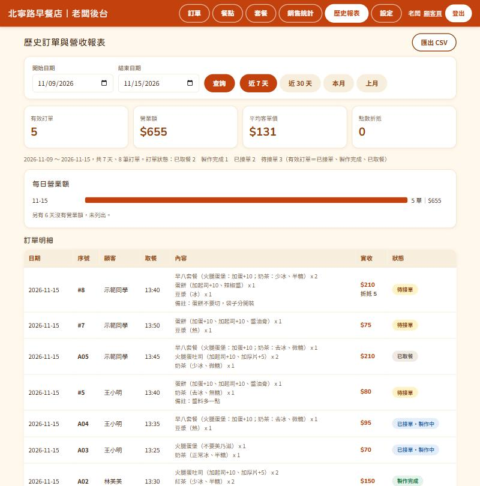

#### UI-11 今日售完

後台將奶茶標記為今日售完後，狀態改為「今日售完」、按鈕變為「恢復供應」；顧客頁含奶茶的早八套餐同步顯示售完（見 UI-09 手機版菜單）。

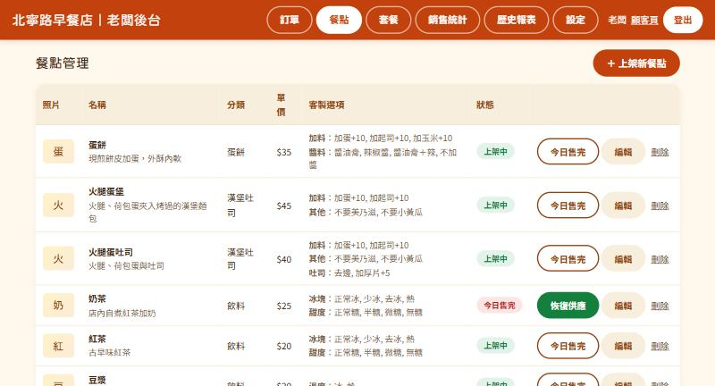

### 4.5 評價顯示

餐點卡片顯示星級摘要，顧客詳情視窗顯示文字留言；老闆後台目前只顯示評價統計。

---

## 5. 資料設計 (Data Design)

現行使用 Neon PostgreSQL，預設獨立 schema breakfast_shop。每次 API 取得交易鎖並讀取快照，save() 標記異動，Storage.save() 以參數化 SQL 儲存異動列；完成後提交，再發送通知。資料庫失敗不降級回 JSON。空資料庫可一次性匯入舊 data.json，轉換 options 為 groups，保留原檔；既有資料不因升級而重設。

### 5.1 資料庫 Schema 與資料實體關係

| 資料表 | 主要資料／約束 |
|---|---|
| users | 帳號不分大小寫唯一、角色、非負點數、加鹽雜湊或第三方身分 |
| menu | 餐點、價格、分類、選項 JSONB、今日售完日期 |
| combos | 套餐價格與內容 JSONB |
| orders | 會員關聯、餐點快照、備註、金額、狀態、歷程、每日取餐號碼唯一 |
| ratings | 訂單／會員關聯、星等及文字，同訂單同品項不重複 |
| sessions | 登入憑證、會員關聯及期限 |
| settings | 營業時間、接單開關及點數門檻 |
| system_state | 資料庫版本、初始化標記及編號計數 |
| photos | 圖片二進位內容、格式、隨機名稱及建立時間 |

選項、套餐內容及歷史訂單快照保留 JSONB，非所有內容均拆成獨立關聯表。歷史訂單不因現行菜單刪除而抹掉品項快照。資料庫已升級至 v3；schema.sql 是建表與升級定義，真正資料位於 Neon。

#### 5.1.1 現行實體資料庫關係

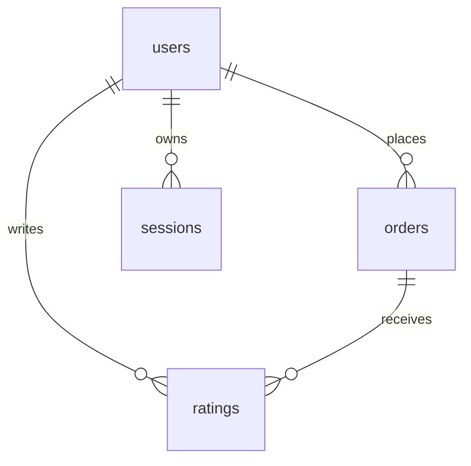

menu、combos、settings、system_state、photos 亦為實體表。menu.photo／combos.photo 是圖片 URL，並未建立 photos 外鍵；ratings.ref、套餐引用與歷史品項亦非全由資料庫外鍵表示。

#### 5.1.2 原業務物件關係圖（保留）

以下為業務概念模型，不是實際 SQL 建表清單。OPTION_GROUP、CHOICE、COMBO_ITEM、ORDER_LINE 是 JSONB 內嵌資料，圖中的 ref 關係不能誤讀為現行資料庫外鍵。

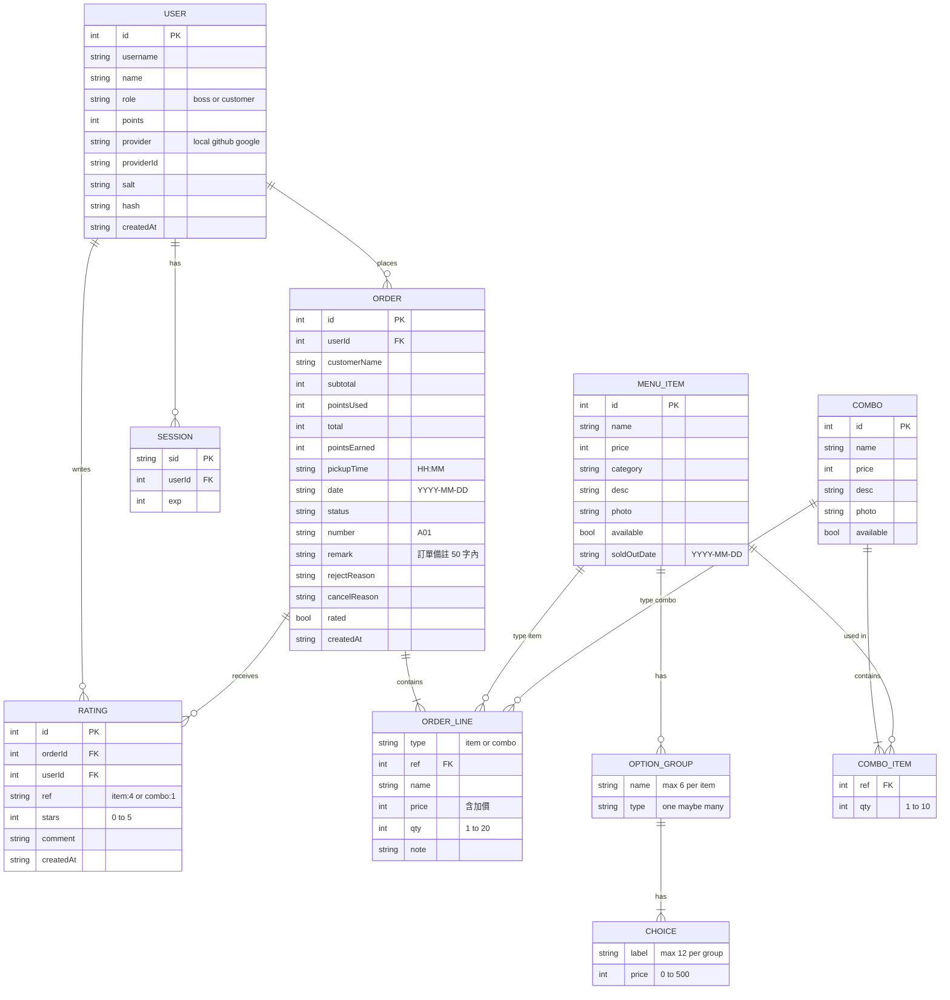

說明：

- `OPTION_GROUP`、`CHOICE`、`COMBO_ITEM` 內嵌於上層物件中，沒有獨立 id。
- `ORDER_LINE` 複製下單當下的品名與含加價單價，之後老闆改價或刪除餐點，舊訂單不受影響。
- 單點的選擇記在 `ORDER_LINE.choices`（群組名稱 → 選項陣列）；套餐記在 `parts`（每個內含品項一組 choices）。
- `RATING.ref` 以「類型:編號」字串同時指向單點或套餐。
- `settings` 為單一物件：營業時間、接單開關、點數門檻。

### 5.2 檔案結構

```
breakfast-shop/
├── server.js          後端：HTTP 伺服器、API、SSE、OAuth、逾時檢查、資料存取
├── config.js          環境變數與安全錯誤訊息
├── storage.js         pg 連線池、交易、資料對應及照片
├── database/          schema.sql、check.js、expand-menu.js
├── test/              隔離資料庫整合測試、池化連線與固定測試時間
├── package.json       Node 版本、依賴及 npm 指令
├── render.yaml        雲端部署設定
├── .env.example       無真實密鑰的設定範例
├── data.json          選用舊資料匯入來源；初始化後不作執行儲存
├── uploads/           舊照片匯入來源；新照片保存資料庫
├── public/
│   ├── index.html     顧客點餐頁
│   ├── boss.html      老闆後台
│   ├── common.js      前端共用：api()、calcChoices()、connectEvents()、toast()、notify()
│   └── style.css      設計系統與全站樣式
├── docs/
│   └── SDD.md         本文件
├── README.md          執行說明、需求對照、API 清單
└── .gitignore
```

### 5.3 JSON 結構

應用程式內快照／舊 JSON 匯入格式如下，不代表現行資料仍存 JSON 檔。數字為歷史範例，非目前正式資料數量：

```json
{
  "seq": { "user": 2, "menu": 6, "combo": 1, "order": 0, "rating": 0 },
  "settings": { "open": "06:00", "close": "21:00", "accepting": true, "pointRate": 30 },
  "users": [],
  "menu": [],
  "combos": [],
  "orders": [],
  "ratings": [],
  "sessions": {}
}
```

餐點（含選項群組）範例：

```json
{
  "id": 3,
  "name": "火腿蛋吐司",
  "price": 40,
  "category": "漢堡吐司",
  "desc": "火腿、荷包蛋與吐司",
  "groups": [
    { "name": "加料", "type": "many", "choices": [{ "label": "加蛋", "price": 10 }, { "label": "加起司", "price": 10 }] },
    { "name": "吐司", "type": "maybe", "choices": [{ "label": "去邊", "price": 0 }, { "label": "加厚片", "price": 5 }] }
  ],
  "photo": "",
  "available": true
}
```

訂單範例：

```json
{
  "id": 12,
  "userId": 2,
  "customerName": "示範同學",
  "items": [
    {
      "type": "item", "ref": 3, "name": "火腿蛋吐司", "price": 55, "qty": 1,
      "note": "加蛋+10、加厚片+5",
      "choices": { "加料": ["加蛋"], "吐司": ["加厚片"] }
    },
    {
      "type": "combo", "ref": 1, "name": "早八套餐", "price": 65, "qty": 1,
      "note": "奶茶：少冰、半糖",
      "parts": [{}, { "冰塊": ["少冰"], "甜度": ["半糖"] }]
    }
  ],
  "subtotal": 120,
  "pointsUsed": 5,
  "total": 115,
  "pointsEarned": 0,
  "pickupTime": "07:45",
  "date": "2026-10-26",
  "status": "已接單",
  "number": "A03",
  "rejectReason": "",
  "rated": false,
  "createdAt": "2026-10-25T23:20:11.000Z",
  "history": [
    { "status": "待接單", "at": "2026-10-25T23:20:11.000Z" },
    { "status": "已接單", "at": "2026-10-25T23:21:40.000Z" }
  ]
}
```

---

### 5.4 完整 SQL 建表與升級定義

以下依目前 database/schema.sql 保留；由 Storage 在獨立 schema 中執行，並非要求讀者直接操作正式資料。

```sql
-- 由程式在獨立 schema 建表，不修改 public 或其他專案。
CREATE TABLE IF NOT EXISTS system_state (key TEXT PRIMARY KEY, value JSONB NOT NULL);
CREATE TABLE IF NOT EXISTS settings (
  id INTEGER PRIMARY KEY CHECK (id = 1),
  open_time TEXT NOT NULL CHECK (open_time ~ '^([01][0-9]|2[0-3]):[0-5][0-9]$'),
  close_time TEXT NOT NULL CHECK (close_time ~ '^([01][0-9]|2[0-3]):[0-5][0-9]$'),
  accepting BOOLEAN NOT NULL, point_rate INTEGER NOT NULL CHECK (point_rate BETWEEN 1 AND 1000),
  CHECK (open_time < close_time)
);
CREATE TABLE IF NOT EXISTS users (
  id INTEGER PRIMARY KEY CHECK (id > 0), username TEXT NOT NULL, name TEXT NOT NULL,
  role TEXT NOT NULL CHECK (role IN ('boss','customer')),
  points INTEGER NOT NULL DEFAULT 0 CHECK (points >= 0), provider TEXT NOT NULL,
  provider_id TEXT, salt TEXT, password_hash TEXT, created_at TIMESTAMPTZ NOT NULL,
  CHECK (provider <> 'local' OR (salt IS NOT NULL AND password_hash IS NOT NULL))
);
CREATE UNIQUE INDEX IF NOT EXISTS users_username_unique ON users(lower(username));
CREATE UNIQUE INDEX IF NOT EXISTS users_provider_unique ON users(provider, provider_id) WHERE provider_id IS NOT NULL;
CREATE TABLE IF NOT EXISTS menu (
  id INTEGER PRIMARY KEY CHECK (id > 0), name TEXT NOT NULL, price INTEGER NOT NULL CHECK (price > 0),
  category TEXT NOT NULL, description TEXT NOT NULL, photo TEXT NOT NULL DEFAULT '', available BOOLEAN NOT NULL,
  option_groups JSONB NOT NULL CHECK (jsonb_typeof(option_groups) = 'array')
);
CREATE TABLE IF NOT EXISTS combos (
  id INTEGER PRIMARY KEY CHECK (id > 0), name TEXT NOT NULL, price INTEGER NOT NULL CHECK (price > 0),
  description TEXT NOT NULL, photo TEXT NOT NULL DEFAULT '', available BOOLEAN NOT NULL,
  items JSONB NOT NULL CHECK (jsonb_typeof(items) = 'array')
);
CREATE TABLE IF NOT EXISTS orders (
  id INTEGER PRIMARY KEY CHECK (id > 0), user_id INTEGER NOT NULL REFERENCES users(id), customer_name TEXT NOT NULL,
  items JSONB NOT NULL CHECK (jsonb_typeof(items) = 'array'),
  subtotal INTEGER NOT NULL CHECK (subtotal >= 0), points_used INTEGER NOT NULL CHECK (points_used >= 0),
  total INTEGER NOT NULL CHECK (total >= 0), points_earned INTEGER NOT NULL CHECK (points_earned >= 0),
  pickup_time TEXT NOT NULL CHECK (pickup_time ~ '^([01][0-9]|2[0-3]):[0-5][0-9]$'),
  order_date TEXT NOT NULL CHECK (order_date ~ '^[0-9]{4}-[0-9]{2}-[0-9]{2}$'),
  status TEXT NOT NULL CHECK (status IN ('待接單','已接單','製作完成','已取餐','已拒絕','已取消')),
  number TEXT, reject_reason TEXT NOT NULL DEFAULT '', cancel_reason TEXT, rated BOOLEAN NOT NULL DEFAULT FALSE,
  created_at TIMESTAMPTZ NOT NULL, history JSONB NOT NULL CHECK (jsonb_typeof(history) = 'array'),
  CHECK (total = subtotal - points_used), UNIQUE (order_date, number)
);
CREATE INDEX IF NOT EXISTS orders_user_date ON orders(user_id, order_date);
CREATE INDEX IF NOT EXISTS orders_date_status ON orders(order_date, status);
CREATE TABLE IF NOT EXISTS ratings (
  id INTEGER PRIMARY KEY CHECK (id > 0), order_id INTEGER NOT NULL REFERENCES orders(id), user_id INTEGER NOT NULL REFERENCES users(id),
  ref TEXT NOT NULL, stars INTEGER NOT NULL CHECK (stars BETWEEN 0 AND 5), comment TEXT NOT NULL,
  created_at TIMESTAMPTZ NOT NULL, UNIQUE (order_id, ref)
);
CREATE INDEX IF NOT EXISTS ratings_ref ON ratings(ref);
CREATE TABLE IF NOT EXISTS sessions (id TEXT PRIMARY KEY, user_id INTEGER NOT NULL REFERENCES users(id), expires_at BIGINT NOT NULL);
CREATE INDEX IF NOT EXISTS sessions_expiry ON sessions(expires_at);

-- v2：相容組長 Iteration 2 的今日售完與訂單備註；既有 v1 資料不重建。
ALTER TABLE menu ADD COLUMN IF NOT EXISTS sold_out_date TEXT;
ALTER TABLE orders ADD COLUMN IF NOT EXISTS remark TEXT NOT NULL DEFAULT '';

-- v3：照片存在雲端資料庫，不依賴部署主機的暫存磁碟。
CREATE TABLE IF NOT EXISTS photos (
  name TEXT PRIMARY KEY CHECK (name ~ '^[a-f0-9]{24}\.(png|jpg|webp|gif)$'),
  content_type TEXT NOT NULL CHECK (content_type IN ('image/png','image/jpeg','image/webp','image/gif')),
  data BYTEA NOT NULL CHECK (octet_length(data) BETWEEN 1 AND 2097152),
  created_at TIMESTAMPTZ NOT NULL DEFAULT now()
);
```

## 6. 類別圖設計 (Class Diagram)

本系統以 JavaScript 函式與物件實作，除 `HttpError` 外，現行另有 Storage 類別。以下以 stereotype 表示程式模組：`<<HTML+JS>>` 為前端頁面、`<<JavaScript>>` 為共用腳本、`<<NodeModule>>` 為 `server.js` 內的模組（依職責分組的函式）、`<<entity>>` 為業務資料物件，由 Storage 對應至 PostgreSQL。

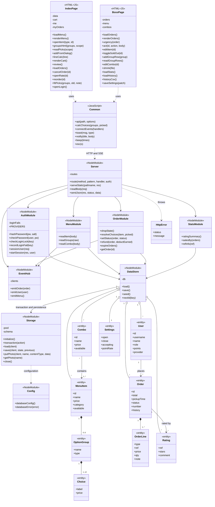

職責說明：

- **Server**：唯一進入點，依 URL 找到路由，檢查登入與角色（customer／boss／任一登入者），解析 JSON 後呼叫處理函式；錯誤統一以 `HttpError` 回應。
- **OrderModule**：`resolveChoices()` 驗證選項並計算加價；所有狀態變更經過 `setStatus()` 以記錄歷程；`expireOrders()` 由計時器每 30 秒呼叫。
- **MenuModule**：`readGroups()` 檢查選項群組數量、選擇方式、重複名稱與加價範圍。
- **AuthModule**：密碼雜湊、Session、登入失敗計數與 OAuth。
- **EventHub**：維護 SSE 連線，依角色與使用者決定推播對象。
- **DataStore**：概念性模組，對應 server.js 的 withState()、load()、save()、seed()、nextId()，不是獨立 class；save() 只標記 dirty，實際 SQL 由 Storage 執行。
- **Storage**：實際宣告於 storage.js 的 class，管理 pg Pool、交易、資料載入與差異儲存及照片。
- **Config**：config.js 的設定與不洩密錯誤訊息函式。
- **Common.calcChoices()**：前端以和後端相同的規則即時計算含加價金額，最終金額仍以伺服器計算為準。

---

## 7. 實作方案 (Implementation Languages and Platforms)

- 平台：手機與桌面瀏覽器的響應式網站。
- 前端：保留原生 HTML、CSS、JavaScript、fetch、dialog、EventSource，以及原設計字型與樣式。
- 後端：Node.js 24 以上，HTTP／crypto 等內建模組搭配 pg 套件。npm ci 安裝，npm start 啟動。
- 服務：Render 執行後端與靜態頁面，Neon 提供 PostgreSQL；SSE、Web Notifications／Audio、scrypt 與 OAuth 沿用既有機制。
- 版本控制：GitHub；PostgreSQL 整合已透過 PR #1 合併至 main。
- 環境設定：本機 .env 不提交 GitHub，雲端使用 Render Environment；實際密鑰不得出現在文件、前端或 PR。

### 7.1 Render 與 Neon 操作設定

網站使用 Render Free，資料庫沿用 Neon Free，不建立 Render Postgres、不加付費磁碟。

| 欄位 | 設定 |
|---|---|
| 類型 | Web Service（不是 Static Site） |
| Repository | https://github.com/AlvinHii/breakfast-ordering-system |
| Branch | feature/postgresql-integration |
| Runtime | Node |
| Region | Singapore |
| Plan | Free，確認畫面顯示 $0/month |
| Root Directory | 留白 |
| Build Command | npm ci |
| Start Command | npm start |
| Health Check Path | /healthz |

環境變數：`NODE_VERSION=24.12.0`、`NODE_ENV=production`、`DB_SCHEMA=breakfast_shop`。
`DATABASE_URL` 填 Neon 連線字串，可用池化網址；`BOSS_PASSWORD` 填至少 12 字元的獨立密碼。這兩項由使用者在 Render 直接填入，不提交 GitHub。

公開網址由 Render 的 `RENDER_EXTERNAL_URL` 自動取得，HTTPS cookie 設 Secure。自訂網域另設 `BASE_URL`。

自動建表升級至 v3。既有老闆若仍用公開預設 `boss1234`，正式啟動時改用 `BOSS_PASSWORD` 並清除該帳號舊 session；既有自訂密碼不會被每次部署覆寫。公開環境停用 demo/demo1234，顧客自行註冊。

照片保存於 PostgreSQL `photos` 表，每張上限 2 MB，網址仍為 `/uploads/隨機檔名`，重新部署後可讀取。啟動時匯入本機 uploads/ 的舊照片並保留原檔；若本機有尚未匯入的照片，先在本機啟動新版完成匯入。圖片占用 Neon 配額，適合少量課程資料，日後大量圖片再考慮物件儲存。

Render Free 閒置後休眠，下次訪問需等待喚醒，不保證全天候立即回應。報告前先開啟並測試。若超過免費限制，先查看控制台，不自動升級付費。

公開 Git URL 部署不一定支援自動更新。修改推送後，在 Render 使用 Manual Deploy；連接 Git Provider 則依平台設定部署。

執行 `npm run test:pooled` 驗證點餐、交易、照片重啟保存、版本升級及正式登入。部署後以公開網址確認 /healthz、菜單、註冊、下單與接單。


### 7.2 第三方登入平台設定

現有程式支援兩個提供者；取得各平台的 OAuth Client ID 與 Secret，設定 Render 後重新部署才能開通。不可把 Secret 提交 GitHub。

網站首頁：https://beining-breakfast.onrender.com/

#### GitHub

在 https://github.com/settings/applications/new 建立 OAuth App：

- Application name：北寧早餐店
- Homepage URL：https://beining-breakfast.onrender.com/
- Redirect URI：https://beining-breakfast.onrender.com/auth/github/callback
- 不啟用 wildcard matching 或 Device Flow。
- Client ID、Client Secret 分別填入 Render 的 `GITHUB_CLIENT_ID`、`GITHUB_CLIENT_SECRET`。

#### Google

在 Google Cloud 的 Google Auth Platform 設定品牌資訊、受眾及 OAuth Client，類型選 Web application。

- Authorized redirect URI：https://beining-breakfast.onrender.com/auth/google/callback
- Client ID、Client Secret 分別填入 Render 的 `GOOGLE_CLIENT_ID`、`GOOGLE_CLIENT_SECRET`。
- 測試模式僅允許指定測試使用者；若要全班使用，須依 Google 控制台要求設定發布狀態。
- 此程式要求 openid、profile，使用識別碼與顯示名稱，不要求信箱或存取儲存庫。

重新部署後，`/api/auth/providers` 對應提供者的 enabled 應為 true。再於網站實際授權、返回、重新整理、登出與再次登入確認同一會員資料。enabled 只代表已填金鑰，仍需實際登入確認。

### 7.3 示範菜單與素材

目前已由 6 道單品、1 個套餐擴充為 20 道單品、4 個套餐。此數量為示範資料現況，不是永久固定的功能限制。`database/expand-menu.js` 可先預覽再套用，跳過同名項目、不在每次啟動時自動執行；老闆後台仍可日常維護菜單。

### 7.4 測試紀錄

| 項目 | 內容 |
|---|---|
| PostgreSQL 整合 | commit 2bd4de9；保留歷史報表、今日售完、再點一次、訂單備註 |
| 照片保存與正式部署保護 | commit d3401aa |
| 菜單擴充工具與 OAuth 設定說明 | commit 72f75d9；菜單擴充為 20 道單品、4 個套餐 |
| 自動化整合測試 | `npm test` 13 項通過（1 個主測試＋12 個子測試），使用隔離的 PostgreSQL 測試 schema |
| 測試內容 | 帳密與角色、菜單套餐設定、照片重啟保存、今日售完、提交後 SSE、訂單點數評價、同時折抵與退款、交易回滾、服務重啟、JSON 匯入、資料庫版本升級、正式環境登入保護 |

---

## 8. 設計議題 (Design Issue)

### 議題 1：取餐序號產生時機

- 議題內容(Issue)：取餐序號在顧客送出時產生，還是老闆接單時產生。
- 背景(Context)：Iteration 1 為送出後立即取號（US-04）；Iteration 2 加入老闆接單與拒絕。
- 考量方案(Alternatives)：
  1. 送出時產生序號，被拒絕的序號作廢。
  2. 老闆接單時才產生序號。
- 決策與理由(Decision and Rationale)：採用方案 2（FR-5）。被拒絕或逾時取消的訂單不占用序號，當日序號連續，叫號不會跳號。
- 後果(Consequences)：顧客送出後先看到「訂購成功、等待店家接單」，接單通知時才取得序號；US-04 的測試方法需改為驗證接單後才有序號。

### 議題 2：客製選項的資料模型

- 議題內容(Issue)：如何表達加料、冰塊、甜度等不同性質的選項。
- 背景(Context)：Iteration 1 只有飲料冰熱的單一下拉選單；Iteration 2 需要可加價、可複選的選項，套餐內的餐點也要能各自選擇（FR-3）。
- 考量方案(Alternatives)：
  1. 每道餐點一份平面選項清單。
  2. 選項群組：每組有選擇方式（one 單選必選、maybe 單選可不選、many 複選），選項可加價。
- 決策與理由(Decision and Rationale)：採用方案 2。三種選擇方式涵蓋冰塊、吐司、加料等情境；套餐直接引用內含餐點的群組，不必另外設定。
- 後果(Consequences)：前端 `calcChoices()` 與後端 `resolveChoices()` 的計價方式必須一致，選擇規則的最終檢查在後端；購物車以「品項＋選擇」判斷是否為同一列；舊資料需在啟動時轉換格式。每道餐點最多 6 組、每組最多 12 個選項，避免畫面過長。

### 議題 3：資料儲存方式

- 議題內容(Issue)：資料存在資料庫還是檔案。
- 背景(Context)：課程時程有限，系統以展示為主，希望組員與老師能直接執行。
- 考量方案(Alternatives)：
  1. 關聯式資料庫（MySQL、PostgreSQL）。
  2. 雲端服務（Firebase）。
  3. 單一 JSON 檔，啟動時載入記憶體。
- 決策與理由(Decision and Rationale)：早期原型採方案 3；Iteration 2 改採方案 1 的 PostgreSQL，由 Neon 託管。理由為跨部署保存資料、支援資料約束及交易，並沿用原 API 與前端物件格式。
- 後果(Consequences)：需要 DATABASE_URL 與 pg 套件；刪除 data.json 不會重設正式資料。現行仍讀完整快照並用共用交易鎖，SSE 尚未跨實例共享，因此維持單一服務實例；大量資料查詢與分頁另列後續優化。

### 議題 4：即時通知技術

- 議題內容(Issue)：如何讓老闆即時收單、顧客即時收到狀態變更。
- 背景(Context)：Iteration 1 以 3～4 秒輪詢，有延遲且浪費請求（FR-7、FR-9）。
- 考量方案(Alternatives)：
  1. 繼續輪詢。
  2. WebSocket。
  3. Server-Sent Events。
- 決策與理由(Decision and Rationale)：採用方案 3。通知只需伺服器到瀏覽器的單向傳輸；SSE 用一般 HTTP、Node.js 內建模組即可實作，瀏覽器斷線會自動重連。
- 後果(Consequences)：每個開啟的頁面占用一條連線；伺服器每 25 秒送心跳避免被中斷。

### 議題 5：逾時未接單的處理

- 議題內容(Issue)：老闆一直沒有接單，取餐時間到了怎麼辦。
- 背景(Context)：顧客已扣除折抵點數，訂單卡在「待接單」會讓顧客空等（FR-10）。
- 考量方案(Alternatives)：
  1. 由老闆手動處理。
  2. 伺服器定期檢查並自動取消。
  3. 每次有請求時才檢查。
- 決策與理由(Decision and Rationale)：採用方案 2，每 30 秒檢查一次，另在伺服器啟動與老闆接單時立即檢查。自動取消時退回點數並推播通知顧客；後台在 10 分鐘內未接單時顯示紅色提醒，提醒老闆處理。
- 後果(Consequences)：定時器間隔為 30 秒，但工作佇列、休眠與喚醒可能增加延遲，不保證 30 秒內完成取消；老闆無法接受取餐時間已過的訂單。

### 議題 6：評價開放時點與已取餐訂單取消

- 議題內容(Issue)：評價要在製作完成還是已取餐後開放；已取餐的訂單能否取消。
- 背景(Context)：SRD 的角色描述寫「取餐後評價」，FR-8 寫「餐點完成後」；FR-6 提到取消已取餐訂單會扣回點數，但狀態圖把已取餐當作終點。
- 考量方案(Alternatives)：
  1. 評價只在已取餐後開放；已取餐不可取消。
  2. 評價在製作完成後即開放；老闆可取消已取餐訂單，用於退款或誤按。
- 決策與理由(Decision and Rationale)：採用方案 2。老闆若忘記按「已取餐」，只在已取餐後開放評價會讓顧客無法評價；可取消已取餐訂單才能處理退款與誤按，並扣回已發點數以避免重複得點。
- 後果(Consequences)：被取消的已取餐訂單不再計入銷售統計；本文件 3.3 狀態圖已加入「已取餐 → 已取消」，SRD 角色描述與 5.2 狀態圖已配合修正。

### 議題 7：價格與點數的信任邊界

- 議題內容(Issue)：訂單金額、加價、取餐時間與點數由誰計算。
- 背景(Context)：前端資料可被竄改，例如修改請求中的價格或選項。
- 考量方案(Alternatives)：
  1. 前端計算後送出總金額。
  2. 前端只送品項、數量與選項名稱，伺服器重新查價並驗證。
- 決策與理由(Decision and Rationale)：採用方案 2（SRD 安全性需求）。伺服器依菜單與選項群組重算單價，檢查營業時間、取餐時間、選項規則、數量 1–20 與點數餘額；前端計算僅供即時顯示。
- 後果(Consequences)：前後端各有一份計價邏輯需同步維護，最終價格與點數以伺服器重新驗證為準。

### 議題 8：登入失敗鎖定的識別方式（回應 NFR-08）

- 議題內容(Issue)：「同一台裝置」要如何識別。
- 背景(Context)：SRD 要求同一台裝置對同一帳號 10 分鐘內失敗 5 次即鎖定 10 分鐘，但未定義裝置識別方式。
- 考量方案(Alternatives)：
  1. 以 cookie 識別裝置。
  2. 以連線來源 IP 加帳號識別。
- 決策與理由(Decision and Rationale)：採用方案 2。攻擊者可以清除 cookie 繞過方案 1；以 IP 加帳號計數不需額外儲存，計數保存在記憶體中。
- 後果(Consequences)：同一網路（同一個對外 IP）的多台裝置會共用計數；伺服器重啟後計數歸零。若部署於反向代理之後，需改用代理提供的真實來源 IP。

### 議題 9：免費部署主機與照片保存

- 議題內容(Issue)：免費主機重新部署後，本機照片可能消失。
- 背景(Context)：需提供全班可開啟的公開網站，且課程專案不採付費方案。
- 考量方案(Alternatives)：
  1. 付費持久磁碟。
  2. 物件儲存。
  3. PostgreSQL BYTEA。
- 決策與理由(Decision and Rationale)：採用方案 3，少量圖片保存於 Neon 的 photos 表，沿用 /uploads/ 網址與 2 MB 上限，避免新增付費磁碟。
- 後果(Consequences)：圖片占用資料庫容量；大量素材時應評估物件儲存。

### 議題 10：資料庫提交與通知順序

- 議題內容(Issue)：不得在資料尚未成功保存時通知顧客已成功。
- 背景(Context)：資料庫 I/O 會失敗，既有同步寫檔路由改成非同步交易。
- 考量方案(Alternatives)：
  1. 路由處理時立即通知。
  2. 先收集事件，交易成功後才發送。
- 決策與理由(Decision and Rationale)：採用方案 2，以 pendingEvents 與 afterCommit 在交易成功後才發送通知或導向回應。
- 後果(Consequences)：回滾時不發成功事件；提交後通知傳送失敗不會撤銷已提交訂單，使用者需可查詢訂單。多實例事件總線尚未實作。
