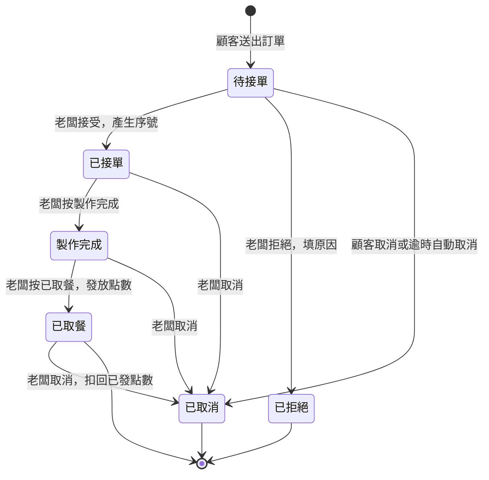

# 專案需求規格文件 (Software Requirements Specification)

## 專案資訊

> **專案名稱**：北寧路早餐店 線上點餐與製作管理系統  
> **版本**：Iteration 2  
> **更新日期**：〔請填日期〕  
> **專案相關資源**：
> * **User Story Map (Miro)**：[Miro](https://miro.com/app/board/uXjVEampUjg=/?moveToWidget=3458764687003124584)
> * **專案管理看板 (Trello)**：[Trello](https://trello.com/invite/b/6acdd531164447f59a868099/ATTI635a8d77ae06fa0bff247e45b187db6bB677A90D/2026軟體工程-早餐店)
> * **原始碼 (GitHub)**：[breakfast-ordering-system](https://github.com/AlvinHii/breakfast-ordering-system)
> * **軟體設計文件 (SDD)**：[docs/SDD.md](https://github.com/AlvinHii/breakfast-ordering-system/blob/main/docs/SDD.md)
> * **Iteration 1 實作成果影片**：[Youtube](https://www.youtube.com/watch?v=fi60h_EUN3s&feature=youtu.be)
> * **Iteration 2 實作成果影片**：[Youtube](https://youtu.be/4qiY5Dn7vMs)

## 版次變更記錄

| 版次 | 變更項目 | 變更日期 |
|---|---|---|
| 0.1 | 原文記載已完成 MVP；原始文件版號與改版日期未提供 | 2026/10/13 |
| 0.2 | 原文件所載功能與實作說明 | 2026/10/27 |
| 0.3 | 對照 Iteration 2 程式碼修正需求：確定評價開放時點與已取餐訂單取消規則（原待確認事項 1、2）、修正 FR-9 拒絕原因與取消範圍、補充 FR-11 加價上限、明定 NFR-08 裝置識別方式、修正狀態機與 API 一覽、新增原始碼與 SDD 連結 | 〔請填日期〕 |
| 1.0 |  |  |

## 目錄

1. [接受準則 (Acceptance Criteria)](#section1)
2. [系統概述 (System Description)](#section2)
3. [操作概念 (Operational Concepts)](#section3)
4. [使用者故事地圖 (User Story Map)](#section4)
5. [使用者介面分析 (User Interface Analysis)](#section5)
6. [功能需求 (Functional Requirements)](#section6)
7. [非功能需求 (Non-functional Requirements)](#section7)
8. [附錄：實作方案與架構](#appendix-implementation)
9. [附錄：Iteration 2 實作成果展示](#appendix-demo)
10. [待確認事項](#pending)

## 接受準則 (Acceptance Criteria of this document)

- Clearly and properly stated（需求需清楚且適當的陳述）
- Complete（需求需完整）
- Consistent with each other（需求之間需維持一致性）
- Uniquely identified（每項需求有明確之識別）
- Appropriate to implement（需求需可被實作）
- Verifiable（需求需可被驗證）

上述為文件品質準則；以下測試方法屬驗證規劃，尚未執行。0.3 版已對照 Iteration 2 程式碼修正前後矛盾之處，仍需組內確認的項目列於末尾「待確認事項」。

## 系統概述 (System Description)

## 1. 專案概述 (Project Overview)

### 1.1 專案背景與痛點
早餐店尖峰時段顧客現場排隊點餐耗時，傳統紙本或口頭點餐容易發生漏單、客製化標註不清（如冰熱糖度、加料）、或廚房製作順序混亂等問題。

### 1.2 專案目標
開發一套輕量、直覺的響應式 Web 線上點餐與店家管理系統。顧客可預先自選手機點餐、預約取餐時間並累積會員點數；老闆可即時接單、管理菜單與套餐、查看銷售統計，減少溝通成本並提升出餐效率。

### 1.3 Iteration 2 更新摘要

| 項目 | Iteration 1 | Iteration 2 |
|---|---|---|
| 角色與權限 | 無登入，店家頁面任何人可開 | 顧客、老闆兩種角色，帳號密碼登入，支援 GitHub / Google 登入 |
| 菜單 | 寫死在程式內 | 老闆後台上下架、編輯、上傳照片 |
| 客製化 | 飲料的冰熱下拉選單 | 選項群組（單選／複選／可加價），套餐內每項可各自選 |
| 套餐 | 無 | 老闆自訂套餐組合與價格 |
| 取餐 | 送出後立即取號 | 預約取餐時間；老闆接單後才產生序號 |
| 訂單狀態 | 製作中 → 製作完成 | 待接單 → 已接單 → 製作完成 → 已取餐，另有已拒絕、已取消 |
| 會員 | 無 | 點數累積與折抵 |
| 評價 | 無 | 0–5 星評分與留言、本月熱門標籤 |
| 統計 | 無 | 今日／本月／全部營業額、客單價、銷售排行、評價分布 |
| 即時更新 | 定時輪詢（3～4 秒） | Server-Sent Events 伺服器主動推播 |
| 資料儲存 | `orders.json` | `data.json`（使用者、菜單、套餐、訂單、評價）與 `uploads/` 照片 |
| 行動裝置 | 版面相容 | 顧客頁、老闆後台皆完成手機版排版 |

## 2. 角色與利害關係人 (Stakeholders & User Personas)

* **顧客 (Customer)**：註冊或登入後瀏覽菜單、自訂餐點、預約取餐時間、使用會員點數折抵、查看訂單進度，餐點製作完成後可評價。
* **老闆 (Boss)**：以老闆帳號登入後台，接受或拒絕訂單、更新製作進度，管理餐點、套餐與營業設定，查看銷售統計。

## 操作概念 (Operational Concepts)

### OC-01 顧客預約點餐

顧客在手機開啟顧客頁 `/`，註冊或登入後瀏覽餐點與套餐，查看照片、價格及評價。顧客選擇加料、冰塊與甜度等選項，將餐點加入購物車並調整份數。結帳時選擇營業時間內的預約取餐時間，決定點數折抵，再核對確認視窗並送出。此時訂單為「待接單」，尚未產生取餐序號。老闆接受後，顧客取得當日序號，依訂單進度與通知前往取餐；餐點製作完成後即可評價，取餐完成後依規則獲得點數。

### OC-02 老闆接單與出餐

老闆以老闆角色登入 `/boss`，接收新訂單提示，檢查預約取餐時間及客製明細，選擇接受或填寫原因拒絕。接受後依取餐時間製作，完成時更新狀態，交付餐點後標記已取餐。未接單且到達取餐時間的訂單由系統取消並退回折抵點數，老闆也無法再接受這類訂單。

### OC-03 店家維護與營運檢視

老闆維護餐點、照片、客製選項及套餐，設定營業時間、暫停接單與點數門檻，並在統計頁檢視各期間營業額、銷售排行與評價分布。顧客無法呼叫老闆專用 API。

## 使用者故事地圖 (User Story Map)

原有完整視覺地圖：[User Story Map (Miro)](https://miro.com/app/board/uXjVEampUjg=/?moveToWidget=3458764687003124584)。下表以由左至右活動呈現文字對照；Iteration 2 各故事已對照 GitHub 上的程式碼確認已實作。

| 層級 | 帳號與進入系統 | 瀏覽與選餐 | 客製與購物車 | 送出與預約 | 接單與製作 | 取餐與後續管理 |
|---|---|---|---|---|---|---|
| 具體任務 | 登入、角色辨識 | 看菜單、套餐與詳情 | 選配料、調整數量 | 確認、折抵、選時間 | 接受、拒絕、更新進度 | 取餐、評價、看統計 |
| 🟩 Iteration 1 / MVP | 無登入 | US-01 菜單瀏覽 | US-02 基礎客製；US-03 購物車 | US-04 確認送出取號 | US-05 製作清單與狀態變更 | US-06 顧客狀態追蹤 |
| 🟨 Iteration 2 | US-07 帳號與權限 | US-08 菜單與套餐維護 | US-09 選項群組與加價 | US-10 預約與點數 | US-11 接單與逾時管理 | US-12 即時通知；US-13 評價；US-14 營運設定與統計 |
| 🟦 Future Scope | 未提供新增規劃 | 前端 React / Vue + Tailwind CSS 重構（技術規劃） | 未提供新增規劃 | 資料庫持久化（技術規劃） | 未提供新增規劃 | US-15 歷史訂單與營收報表 |

> Iteration 1 的「送出取號」為歷史版本行為；Iteration 2 改為老闆接單後取號。資料庫與前端重構屬技術規劃，不冒列為已完成的使用者功能。

### MVP 使用者故事卡片

以下測試以 Iteration 1 行為為基準；驗證現行 Iteration 2 時，須套用 FR-1 至 FR-14 的新規則。

#### US-01 菜單瀏覽

- **代號**：US-01
- **故事**：作為顧客，我想要瀏覽餐點名稱及價格，以便於選擇想要的早餐。
- **註記**：對照原文 Iteration 1 菜單功能。
- **測試方法**：開啟菜單，逐項比對名稱與價格是否正確顯示。

#### US-02 基礎客製

- **代號**：US-02
- **故事**：作為顧客，我想要選擇飲料冰熱，以便於取得符合偏好的餐點。
- **註記**：Iteration 1 為飲料冰熱下拉選單；Iteration 2 由 FR-3 擴充。
- **測試方法**：選擇冰或熱並加入購物車，確認訂單明細保留該選項。

#### US-03 購物車管理

- **代號**：US-03
- **故事**：作為顧客，我想要加入餐點及調整數量，以便於核對欲購買品項與金額。
- **註記**：現行規則對照 FR-4。
- **測試方法**：加入餐點並增減數量，確認小計與總額；數量減到 0 時確認品項移除。

#### US-04 確認送出取號

- **代號**：US-04
- **故事**：作為顧客，我想要確認明細後送出訂單並取得序號，以便於完成點餐並辨識自己的訂單。
- **註記**：此為 Iteration 1 故事；Iteration 2 取號時點依 FR-5 變更。
- **測試方法**：於 Iteration 1 版本送出訂單，確認明細及序號；現行版改驗證待接單時無序號、接受後才有序號。

#### US-05 製作清單與狀態變更

- **代號**：US-05
- **故事**：作為老闆，我想要查看製作清單並標記完成，以便於管理出餐進度。
- **註記**：Iteration 1 無登入；現行後台需老闆權限。
- **測試方法**：顧客送單後確認清單出現對應品項及客製資訊，標記完成後確認狀態變更。

#### US-06 顧客狀態追蹤

- **代號**：US-06
- **故事**：作為顧客，我想要查看自己的訂單製作狀態，以便於掌握何時可取餐。
- **註記**：Iteration 1 使用輪詢；Iteration 2 使用 SSE。
- **測試方法**：老闆變更狀態後，確認顧客端對應訂單更新；記錄實際延遲，不將歷史輪詢週期當作實測保證。

### Iteration 2 與未來故事對照

| 代號 | 故事 | 需求依據／測試重點 |
|---|---|---|
| US-07 | 作為顧客，我想要註冊或登入帳號，以便於保存個人訂單並使用會員功能。 | FR-1；驗證合法／不合法註冊及顧客無法存取老闆 API |
| US-08 | 作為老闆，我想要維護餐點與套餐，以便於即時呈現店內供應內容。 | FR-2、FR-11、FR-12；上下架及套餐引用限制 |
| US-09 | 作為顧客，我想要選擇可加價的單選或複選選項，以便於清楚訂購客製餐點。 | FR-3、FR-4；必選、複選、加價及不同選項分列 |
| US-10 | 作為顧客，我想要預約取餐並使用點數折抵，以便於安排取餐時間並使用會員優惠。 | FR-5、FR-6；15 分鐘、5 分鐘粒度、打烊及折抵邊界 |
| US-11 | 作為老闆，我想要接受或拒絕訂單並管理製作進度，以便於依產能安排出餐。 | FR-9、FR-10；拒絕原因、逾時取消及點數退回 |
| US-12 | 作為顧客，我想要收到訂單狀態變更通知，以便於及時掌握接單與取餐進度。 | FR-7；前景提示、背景通知與 SSE 更新 |
| US-13 | 作為顧客，我想要為訂單餐點評分與留言，以便於提供用餐回饋。 | FR-8；製作完成或已取餐後開放、0–5 星、200 字及每單一次 |
| US-14 | 作為老闆，我想要調整營業設定並查看統計，以便於管理營運與銷售表現。 | FR-13、FR-14；期間切換、有效狀態與加總正確性 |
| US-15 | 作為老闆，我想要查詢歷史訂單與更完整營收報表，以便於回顧長期營運情形。 | Future Scope；查詢期間、欄位及驗收標準尚未提供 |

## 使用者介面分析 (User Interface Analysis)

以下依原文介面描述整理；畫面設計與視覺規範見 SDD 第 4 節，實際截圖待補。

| 編號 | 核心介面 | 說明與需求對照 | 驗證方法 |
|---|---|---|---|
| UI-01 | 登入與註冊 | 顧客註冊、帳密與第三方登入；FR-1、US-07 | 檢查欄位規則、錯誤提示及角色導向 |
| UI-02 | 顧客菜單 `/` | 分類、照片、單價、評分、熱門標籤與詳情；FR-2 | 比對餐點資料與詳情顯示 |
| UI-03 | 客製與套餐選項 | 單選／複選按鈕、加價、套餐各品項設定；FR-3 | 驗證選擇限制及含加價金額 |
| UI-04 | 一頁式購物車與確認視窗 | 數量、小計、點數、取餐時間、訂單明細；FR-4～FR-6 | 調整數量與折抵，核對送出前後明細 |
| UI-05 | 我的訂單 | 進度條、大字序號、提示音與通知、評價入口；FR-7、FR-8 | 逐狀態檢查進度與操作可用性 |
| UI-06 | 老闆訂單後台 `/boss` | 待接單、製作清單、待取餐、今日已結束及逾時提醒；FR-9、FR-10 | 對照排序、拒絕原因、序號及狀態操作 |
| UI-07 | 餐點、套餐及營業設定 | 表單、照片、選項群組、接單開關；FR-11～FR-13 | 驗證欄位上限及供應狀態同步 |
| UI-08 | 銷售統計 | 期間切換、營業額、排行與評價分布；FR-14 | 以已知訂單資料逐項核對 |
| UI-09 | 手機版介面 | 後台表格改卡片、分頁列可滑動；原文相容性需求 | 建議於 375px、768px、1280px 寬度檢查操作與溢出；尺寸待確認 |

## 功能需求 (Functional Requirements)

## 3. 功能性需求 (Functional Requirements)

### 3.1 帳號與權限
* **FR-1 帳號登入**：
  * 顧客可自行註冊（帳號 3–20 個英數字或底線、密碼至少 6 字元、暱稱 20 字以內），也可使用 GitHub、Google 第三方登入。
  * 老闆為獨立角色；後台所有功能的 API 都會在伺服器端驗證角色，顧客無法呼叫。

### 3.2 顧客端功能 (Customer Side)
* **FR-2 菜單瀏覽**：
  * 依分類展示餐點與套餐，顯示照片、名稱、單價、平均評分，以及「本月熱門」標籤（本月銷量前 3 名）。
  * 點選餐點可查看說明、客製選項、星等分布與顧客評論。
* **FR-3 客製化選項選擇**：
  * 每道餐點可有多組選項群組，選擇方式分三種：

    | 方式 | 例子 | 規則 |
    |---|---|---|
    | 單選（必選） | 冰塊：正常冰、少冰、去冰、熱 | 一定要選一個，預設第一個 |
    | 單選（可不選） | 吐司：去邊、加厚片 +5 | 最多選一個 |
    | 複選 | 加料：加蛋 +10、加起司 +10 | 可選多個 |

  * 選項可加價，加入訂單按鈕即時顯示含加價的金額。
  * 套餐會列出內含每一項餐點的選項（如早八套餐的奶茶可選冰塊、甜度），加料費用加在套餐價格上。
* **FR-4 購物車管理**：
  * 即時計算小計與總額；調整數量（＋／－），減到 0 即移除。
  * 相同餐點但選項不同，會分成不同品項。
  * 餐點被老闆下架時，購物車自動移除該品項。
* **FR-5 預約取餐與送出訂單**：
  * 只能在營業時間內下單（預設 06:00–21:00，老闆可修改或臨時暫停接單）。
  * 取餐時間以 5 分鐘為單位，需在下單後至少 15 分鐘，且不晚於打烊時間。
  * 送出前跳出確認視窗，列出明細、點數折抵與合計。
  * 送出後顯示「訂購成功、等待店家接單」，**取餐序號（A01、A02…，每日重編）在老闆接單時才產生**。
* **FR-6 會員點數**：
  * 取餐完成後，每消費 30 元獲得 1 點（門檻老闆可調）。
  * 下單時可用點數折抵，1 點 = 1 元，折抵金額不會超過訂單小計。
  * 訂單被拒絕或取消時，退回已使用的點數；老闆取消已取餐訂單時，同時扣回該筆訂單獲得的點數。
* **FR-7 訂單狀態追蹤與通知**：
  * 「我的訂單」以進度條顯示：待接單 → 已接單 → 製作完成 → 已取餐。
  * 老闆接單、餐點完成、訂單被拒絕、逾時自動取消或店家取消時，畫面跳出提示並播放提示音；分頁在背景時顯示瀏覽器通知。
  * 顧客在「待接單」階段可自行取消訂單；店家處理後需聯絡店家。
* **FR-8 評價**：
  * 訂單狀態為「製作完成」或「已取餐」時，可對訂單內每項餐點打 0–5 顆星並留言（最多 200 字，可不填）。
  * 每筆訂單只能評價一次。

### 3.3 老闆後台功能 (Boss Side)
* **FR-9 訂單管理**：
  * 新訂單即時推播到後台，並有提示音與閃爍標示。
  * 版面分為「待接單」「製作清單」「待取餐」「今日已結束」；製作清單依取餐時間排序。
  * 可接受或拒絕訂單；拒絕時填寫原因（最多 50 字，預設「餐點售完」，未填寫則顯示「店家無法接單」），並顯示給顧客。
  * 接單後依序按「製作完成」「已取餐」；除「已拒絕」「已取消」外，老闆都能取消訂單（包含已取餐，用於退款或誤按）。
  * 待接單訂單距離取餐 10 分鐘內，卡片會顯示紅色提醒。
* **FR-10 訂單逾時自動取消**：
  * 取餐時間到了仍是「待接單」的訂單，系統每 30 秒檢查一次並自動取消、退回點數，並通知顧客。
  * 老闆無法接受取餐時間已過的訂單。
* **FR-11 餐點管理**：
  * 新增、編輯、刪除、上下架；欄位含名稱、單價、分類、說明、照片、客製選項群組。
  * 一道餐點最多 6 組選項群組，每組最多 12 個選項；每個選項加價 0–500 元；同一餐點的群組名稱、同一群組的選項名稱不可重複。
  * 照片在瀏覽器先縮圖再上傳；被套餐使用的餐點無法刪除，需先改套餐或改為下架。
* **FR-12 套餐管理**：
  * 設定套餐名稱、價格、內含餐點與數量、照片、說明、上下架；後台顯示單點合計作為對照。
* **FR-13 營業設定**：
  * 設定營業時間、臨時暫停接單、會員點數門檻。
* **FR-14 銷售統計**：
  * 可切換今日、本月、全部。
  * 顯示有效訂單數、營業額、平均客單價、點數折抵總額、各分類的餐點銷售排行（份數與金額）、各狀態訂單數。
  * 餐點評價表：平均星數、評價數、各星等分布。
  * 「有效訂單」指已接單、製作完成、已取餐三種狀態。

## 非功能需求 (Non-functional Requirements)

## 4. 非功能性需求 (Non-Functional Requirements)

* **易用性 (Usability)**：介面乾淨簡約，採一頁式購物車與大字體取餐序號；客製選項以可點選的按鈕呈現，手機操作方便。
* **即時性 (Responsiveness)**：以 Server-Sent Events 取代輪詢。訂單狀態變更只需要伺服器往瀏覽器單向推送，SSE 已足夠，且不需額外套件；連線斷開時瀏覽器會自動重連。
* **跨裝置支援 (Compatibility)**：顧客頁與老闆後台皆完成手機版排版。後台表格在窄螢幕改為卡片、分頁列可左右滑動，已用手機尺寸實測。
* **安全性 (Security)**：
  * 密碼以 scrypt 加鹽雜湊儲存；登入以 HttpOnly、SameSite=Lax 的 cookie，有效 7 天。
  * 寫入類 API 只接受 JSON，搭配 SameSite cookie 防止跨站請求偽造。
  * 價格、選項、數量（1–20）、取餐時間與點數一律由伺服器重新檢查與計算，不信任前端傳來的金額。
  * 照片只接受 PNG、JPG、WEBP、GIF，上限 2 MB，檔名隨機產生。
  * 輸出到畫面的文字皆做 HTML 跳脫。
  * 同一來源 IP 對同一個帳號 10 分鐘內登入失敗 5 次，暫時鎖定 10 分鐘。
* **資料完整性**：存檔先寫入暫存檔再改名，寫入中途當機也不會損毀原本的 `data.json`；舊版資料在啟動時自動轉換格式。

### 非功能需求識別與驗證對照（新增）

保留上述原文全文；下表為其唯一識別與驗證方式，不代表測試已通過。

| 編號 | 原文需求範圍 | 驗證方式 |
|---|---|---|
| NFR-01 | 易用性 | 依 UI-03～UI-05 核對可點選選項、一頁購物車及序號可辨識性；量化可用性標準待提供 |
| NFR-02 | SSE 即時更新與自動重連 | 同時開啟顧客及老闆視窗變更狀態，模擬斷線再恢復，檢查重連與資料一致性 |
| NFR-03 | 跨裝置支援 | 依 UI-09 檢查卡片、滑動與核心操作；原文稱已實測，但未提供測試紀錄 |
| NFR-04 | 密碼與登入 cookie | 檢查 scrypt 加鹽儲存、HttpOnly、SameSite=Lax 與 7 天期限 |
| NFR-05 | 寫入 API 與金額驗證 | 測試非 JSON 請求、竄改金額、數量 0／21、非法取餐時間及超額折抵均依規則處理 |
| NFR-06 | 圖片上傳限制 | 驗證允許格式、2 MB 邊界、超限檔案及隨機檔名 |
| NFR-07 | HTML 跳脫 | 以含 HTML 標記之文字測試畫面以文字呈現，不執行標記 |
| NFR-08 | 登入失敗鎖定 | 以「連線來源 IP＋帳號」計數；同一組合 10 分鐘內失敗 5 次後回應 HTTP 429 並鎖定至 10 分鐘期滿；登入成功即清除計數；另以不同帳號或不同來源 IP 確認不受影響 |
| NFR-09 | 資料完整性與舊版轉換 | 以測試資料模擬寫入中斷及舊格式啟動，確認原檔完整與轉換結果 |

### 效能需求（建議草案，待團隊確認與實測）

原文提供輪詢歷史週期與逾時檢查週期，但未提供現行系統延遲、負載及容量的驗收門檻。以下數字為新增提案，不能當作既有成果或保證。

| 編號 | 建議可量測標準 | 測試方式 |
|---|---|---|
| PERF-01 | 在雙方約定測試環境、10 個同時登入使用者下，100 次菜單請求至少 95 次於 2 秒內完成回應 | 記錄 `/api/menu` 請求送出至回應完成時間及錯誤率 |
| PERF-02 | 在同一環境、10 條 SSE 連線下，100 次訂單狀態變更至少 95 次於 2 秒內更新顧客畫面 | 記錄伺服器完成狀態變更至畫面更新時間 |
| PERF-03 | 在同一環境、10 個同時登入使用者下，100 次有效送單至少 95 次於 3 秒內顯示結果，且每次僅建立一張訂單 | 記錄確認送出至顯示成功時間，核對訂單紀錄 |

測試前須記錄主機規格、Node.js 版本、瀏覽器版本、網路條件及資料量；上述條件與門檻待團隊核定。

## 附錄：實作方案與架構

## 5. 實作方案與架構 (Implementation)

詳細設計（架構圖、介面、流程、資料與類別圖）見 [軟體設計文件 SDD](https://github.com/AlvinHii/breakfast-ordering-system/blob/main/docs/SDD.md)。

### 5.1 系統架構

* **後端**：Node.js 內建模組（`http`、`fs`、`crypto`），無第三方套件，提供 REST 風格 JSON API。第三方登入使用 Node 18 內建 `fetch`。
* **前端**：原生 HTML / CSS / JavaScript，以 `fetch` 呼叫 API，`<dialog>` 做對話框，`EventSource` 接收推播。顧客頁 `/`，老闆後台 `/boss`。
* **資料儲存**：`data.json`（原型階段），照片存於 `uploads/`。
* **時間處理**：營業時間、取餐序號、統計一律以台北時區計算。

### 5.2 訂單狀態機

> 「製作完成」與「已取餐」狀態下顧客可評價一次（FR-8）。「已取餐」通常為終點，僅在老闆取消時轉為「已取消」（FR-6、FR-9）。

### 5.3 API 一覽

| Method | Path | 權限 | 說明 |
|---|---|---|---|
| POST | /api/register、/api/login、/api/logout | — | 註冊、登入、登出；登入失敗過多回 429 |
| GET | /api/me | — | 目前登入者 |
| GET | /api/auth/providers | — | 第三方登入是否已設定 |
| GET | /auth/:provider、/auth/:provider/callback | — | GitHub / Google 登入與回呼 |
| GET | /api/menu | — | 菜單、套餐、營業狀態、評分摘要、本月熱門 |
| GET | /api/ratings/:ref | — | 某餐點的評論 |
| POST | /api/orders | 顧客 | 送出訂單 |
| GET | /api/my/orders | 顧客 | 我的訂單 |
| POST | /api/orders/:id/cancel | 顧客 | 取消（限待接單） |
| POST | /api/orders/:id/rate | 顧客 | 送出評價（限製作完成或已取餐） |
| GET | /api/events | 登入者 | 即時推播（SSE） |
| GET | /api/boss/orders | 老闆 | 今日與未結束訂單 |
| POST | /api/boss/orders/:id/accept、reject、status、cancel | 老闆 | 接單、拒絕、更新狀態、取消 |
| GET / POST / PUT / DELETE | /api/boss/menu、/api/boss/combos | 老闆 | 餐點與套餐管理 |
| POST | /api/boss/upload | 老闆 | 上傳照片 |
| GET / PUT | /api/boss/settings | 老闆 | 營業時間、接單開關、點數門檻 |
| GET | /api/boss/stats?range=today\|month\|all | 老闆 | 銷售統計 |

### 5.4 迭代規劃 (Iterations)

* **Iteration 1（已完成）**：菜單瀏覽、客製、購物車、確認送出取號、店家製作清單與狀態變更、顧客端狀態追蹤。
* **Iteration 2（目前進度）**：
  * 帳號與角色權限、第三方登入。
  * 老闆後台：餐點、套餐、營業設定、訂單管理、銷售統計。
  * 預約取餐、會員點數、評價與熱門標籤。
  * 客製選項群組與加價、訂單逾時自動取消。
  * 以 SSE 取代輪詢、手機版排版。
* **後續規劃**：
  * 加入資料庫（MongoDB / PostgreSQL）持久化。
  * 前端改用 React / Vue + Tailwind CSS。
  * 歷史訂單查詢與更完整的營收報表。

## 附錄：Iteration 2 實作成果展示

## 6. Iteration 2 實作成果展示 (Demo 說明)

影片以兩個 Chrome 視窗同時操作，一個登入顧客、一個登入老闆：

**顧客端**
1. 登入後瀏覽菜單，點選餐點並自訂選項（加料、冰塊、甜度），按鈕即時顯示含加價的金額。
2. 加入購物車，調整數量。
3. 使用會員點數折抵，選擇預約取餐時間。
4. 確認訂單並送出，畫面顯示「訂購成功、等待店家接單」。

**老闆端**
5. 後台即時出現新訂單並發出提示音，老闆按「接受」，顧客端收到通知並取得取餐序號。
6. 老闆按「製作完成」，顧客端更新為「餐點完成，請取餐」。
7. 查看銷售統計：營業額、客單價、銷售排行。
8. 查看套餐建立畫面與餐點調整畫面。

## 待確認事項

0.3 版已依 Iteration 2 程式碼的現行行為處理原待確認事項 1、2，並同步修正相關段落；若組內決定改變規則，需同時修改程式與本文件。

1. **評價開放時點（已處理，待組內確認是否維持）**：依現行程式，訂單為「製作完成」或「已取餐」時即可評價。已修正角色描述、OC-01、FR-8、US-13 與 5.2 狀態機說明。
2. **已取餐訂單取消（已處理，待組內確認是否維持）**：依現行程式，老闆可取消「已拒絕」「已取消」以外的所有訂單，包含已取餐；取消已取餐訂單時扣回已發點數，該訂單不再計入銷售統計。已修正 FR-9 與 5.2 狀態機。
3. **資料未提供**：發展者、原始撰寫日期、UI 截圖／Wireframe、測試紀錄與效能實測結果仍待補。部署方式已記載於 SDD 第 7 節。
4. **新增指標待確認**：PERF-01～PERF-03 為建議草案；UI-09 測試尺寸亦為建議。
